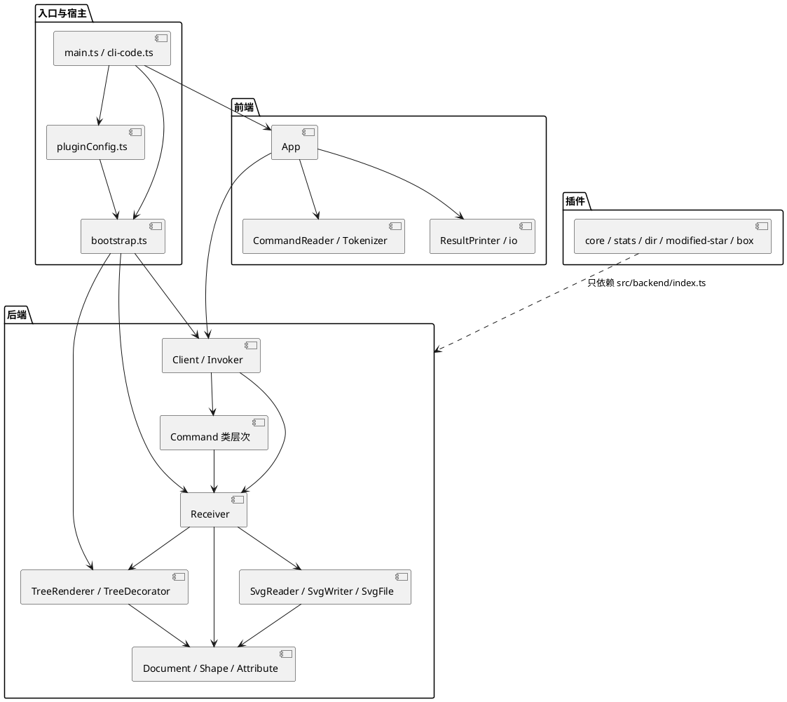

# CLI 架构说明

本文件描述 `cli/` 的详细架构。验收结果与证据见 [验收资料](acceptance.md)，课程交付文档的总览见 [doc/README.md](../../doc/README.md#phase-2-cli)。

## 1. 定位与边界

CLI 是一个独立的 Node.js/TypeScript 程序，负责在 REPL 中创建、编辑、组织 SVG 图形，并读写 SVG 文件。它由配置或代码装配插件，自身不认识具体图形类型和具体命令。

- CLI 包位于 `cli/`，依赖和脚本都在包内；根目录不承载 CLI 源码或 npm 配置。
- VS Code 扩展位于 `vscode-extension/`，是独立产品。两者源码互不引用，扩展不 import `cli/src`、`cli/plugins`，CLI 也不 import `vscode`。
- 插件只依赖内核公开入口 `src/backend/index.ts`，不依赖宿主装配模块或内核内部实现。
- CLI 的输入输出、文件访问和持久化实现都在自己的包内，不依赖扩展。

## 2. 目录与分层

```text
cli/
├── src/
│   ├── main.ts                 配置入口：解析 --config，装配插件并启动
│   ├── cli-code.ts             代码入口：静态导入插件后装配
│   ├── bootstrap.ts            宿主：清单校验、贡献注册、候选会话与命令表
│   ├── pluginConfig.ts         配置解析、模块加载与失败分类
│   ├── runCli.ts               构造控制台输入输出并运行 App
│   ├── App.ts                  CLI 主循环：读取、执行、展示、错误转换
│   ├── backend/
│   │   ├── index.ts            内核公开契约与实现导出
│   │   ├── Client.ts           命令分派与框架入口
│   │   ├── PluginContributions.ts  插件贡献类型
│   │   ├── command/            Command、EditCommand、DocumentCommand、CommandResult
│   │   ├── invoker/            Invoker：执行与撤销/重做历史
│   │   ├── error/              EditorError
│   │   ├── utils/              DecimalFormat
│   │   └── receiver/
│   │       ├── Receiver.ts     编辑会话接收者
│   │       ├── document/       Document、ShapeNode、Shape、属性、工厂、快照、视图
│   │       ├── svg/            SvgFile、SvgReader、SvgWriter
│   │       └── tree/           TreeLineRenderer、BaseTreeLineRenderer、TreeDecorator、TreeRenderer
│   └── frontend/
│       ├── CommandReader.ts    读行、提示符与脚本回显
│       ├── Tokenizer.ts        分词
│       ├── ResultPrinter.ts    输出格式与错误前缀
│       ├── ParseError.ts       前端解析错误
│       └── io/                 InputSource / OutputSink 及控制台实现
├── plugins/
│   ├── core/                   六种基础图形与 17 个命令形式
│   ├── stats/                  stats 查询命令
│   ├── dir/                    dir 目录查询命令与 DirectoryAccess 适配器
│   ├── modified-star/          保存基准与树标签
│   └── box/                    Box 复合图形、属性处理器与类型标签
├── test/                       与 src/ 对应的单元、宿主与插件测试
│   └── fixtures/transcript/    CLI 回放输入、期望输出与 SVG 样例
├── scripts/                    回放校验与源码指标
├── docs/
│   ├── architecture.md         详细架构
│   ├── acceptance.md           验收结果、检查点与证据
│   ├── plugins.md              插件包编写说明
│   └── evidence/               验收快照、help 与指标报告
├── plugins.config.json         发行配置
├── package.json / package-lock.json
├── tsconfig.json / vitest.config.ts
└── README.md                   安装、运行、目录与验证说明
```

分层关系：



`frontend` 与 `backend` 互不依赖；`App` 是两侧唯一的转换点：把字符串参数数组交给后端，把 `CommandResult` 拆成字符串交给前端。

## 3. 领域模型

### 3.1 Shape

`Shape` 是单个图形的领域模型，封装自身状态、属性和行为，不保存文档树关系。

- 每个实例持有 SVG id，并在类级属性模板中声明自己有哪些属性。`params` 是必填属性模板，默认也作为创建参数；`paint` 声明可选外观参数；`anchor` 声明 move 回显使用的坐标属性；`content` 声明写成子文本的 SVG 属性。
- `attributes()` 把图形自身属性与统一声明的 `fill`、`stroke`、`stroke-width` 合并；复合模型可以覆写属性表选择不合并外观。
- `validate()` 检查必填、跨属性约束和私有部件结构。构造只建立结构，完整模型的创建和编辑都由 `Receiver` 的入口以 `validate()` 收尾。
- `move` / `scale` 是抽象方法，由各模型按自身属性实现。缩放系数、坐标与尺寸的文本规则由 `DecimalFormat` 统一。
- `capture()` 生成 `ShapeMemento`，保存自身及需要一起恢复的私有部件；恢复动作封装在闭包中，不暴露内部对象。
- `parse(id, attributes, readChildren)` 是静态数据构造契约：模型解析属性、按需消费子 Shape，返回 `{ shape, parts, children }`。`parts` 是已消费的私有部件，`children` 是仍应成为文档成员的输入 Shape；递归由 `SvgReader` 编排。
- `toSvg()` 返回自身及私有部件的纯数据元素 `SvgElement`。默认实现通过受保护的 `parts()` 递归组合；`element()` 默认等于 `type`，复合模型可覆写为实际写出的 SVG 标签（如 Box 的 `g`），此时基类自动写 `data-kind`。
- `identifiers()` 声明自身及私有部件占用的全部 id，默认由 `parts()` 递归汇总。`viewParts()` 提供只读展示视图，供 tree/show 使用。
- `modelLabel()` 是命令回显的 `<type>#<id>`，`fileLabel()` 是 tree/show 的文件身份 `<element>#<id>`。

`Shape` 不依赖 `Document`、Handler 注册表、Command、CLI 或 SVG 解析器。图形树、全局 id 和持久化格式分别由上层负责。

### 3.2 Attribute

图形属性的值与规则位于 `receiver/document/shape/attribute/`。`Attribute` 及其子类负责单项值的解析、校验、展示和默认值：

- `NumericAttribute`、`LengthAttribute`、`StrokeWidthAttribute`、`StringAttribute`、`TextAttribute` 分别表达不同约束。
- 类级属性模板按名字和顺序声明属性；`Shape` 构造时按模板建立实例属性表，未赋值时值为 `null`。
- 命令参数、属性对象和 SVG 读写共用 `backend/utils/DecimalFormat` 的十进制文本规则。

策略模式在这里解决“不同属性的取值规则不同，但创建、set、show、save 要统一处理”的问题，模型不按属性名分支。

### 3.3 ShapeNode 与 Document

`ShapeNode` 以 `Shape` 为 value，保存只读的父子关系；节点不另设 id 或 index，index 来自父节点列表。`Document` 管理节点树：

- 画布信息、顶层节点和节点查找。`findNode(id)` / `requireNode(id)` 返回已有节点，通过 `node.value` 获取模型，不重新解析文本或构造新对象。
- 顶层与容器内的 `insert`、`relocate`、`remove`。涉及树结构的变更必须经过维护文档级约束的公开入口。
- 全局 id 唯一性。`insert` 和结构快照恢复前统一验证节点及私有部件的全部 id，失败不修改关系。
- `shapeViews()` 提供冻结的只读视图，供 tree/show 消费；复合模型的私有部件视图排在普通文档成员之前。
- `DocumentStructureMemento` 保存节点身份、层级和顺序，供结构命令撤销。

`Document` 不依赖 `svg`、`tree`、`Command`、Handler 注册表或 CLI，也不集中实现具体图形的标题、填充等内部行为。

## 4. 领域操作：Handler 与 Receiver

`AttributeHandler` 是可注册的领域属性方法，契约与注册表和 `Shape` 放在同一目录。具体 Handler 由业务插件提供，注册静态类本身而不是实例：

```text
handlerName
matches(shape, key): boolean
apply(shape, key, token): void
display(shape, key): string | null
```

- `AttributeHandlerRegistry` 按注册顺序调用 `matches`，首个命中即停止；无命中时使用模型自身的属性规则。
- `Receiver.write` 是创建和编辑共用的唯一写入动作：解析一次匹配，零命中调用 `Shape.set`，命中调用 `apply`。
- `Receiver.set` 在同一次匹配内读取旧值、写入、整图校验、读取新值，返回前后回显；`Receiver.createShape` 逐项复用同一写入，最后校验一次。
- Handler 可以组合模型公开方法完成领域规则，但不自行回滚。写入、校验或回显失败时，由编辑命令按快照恢复并传播原错误。
- Handler 不承担 CLI 分词、输出格式、文件 I/O、插件加载或历史管理。

## 5. 应用服务：Command、Invoker 与 Client

### 5.1 Command

`Command` 是抽象命令。静态成员即命令定义：

```text
command   命令名
usage     用法
accepts   同名多形式下判断参数结构是否适用
```

子类在构造时解析参数并校验，每次执行都是一个独立对象。`execute()` 返回 `CommandResult`。

命令分三种生命周期：

| 类别 | 基类 | 历史规则 | 典型命令 |
| --- | --- | --- | --- |
| 编辑 | `EditCommand` | 成功后入撤销栈，清空重做栈 | create、delete、move、scale、set、group、ungroup、addto、front、back |
| 文档 | `DocumentCommand` | 成功后清空历史并禁止 undo/redo，直到下一次编辑成功 | init、read、save、canvas 尺寸调整 |
| 查询/显示 | `Command` | 不影响历史 | help、tree、show、canvas、stats、dir |

`EditCommand` 用模板方法统一组织一次编辑：

1. `snapshot()` 取得恢复范围（`ShapeMemento` 或 `DocumentStructureMemento`）。
2. `apply()` 执行修改，返回当前回显和撤销回显。
3. 成功后才保存快照和撤销回显；失败时 `restore()` 恢复并抛出原错误。
4. `undo()` 恢复快照并返回撤销回显；redo 再次调用 `execute()`，按同一路径重新取快照和执行。

一次用户编辑构成一个 undo 单元；子类调用多个领域方法也整体撤销、整体重做。编辑命令不引入通用会话事务框架。

`DocumentCommand.successKind()` 声明成功通知类型（`replace` / `save` / `edit`），历史规则仍由 Invoker 按基类判断。

### 5.2 Invoker

`Invoker` 执行命令并维护两个栈：

- 编辑命令成功后入撤销栈、清空重做栈并解禁 undo/redo。
- 文档类命令成功后清空两个栈并禁止 undo/redo。
- 查询/显示命令不影响历史；失败命令不改变历史。
- `undo()` 弹出最近编辑命令并调用其 `undo()`；`redo()` 再次执行重做栈顶命令。

### 5.3 Client

`Client` 是 CLI 会话的命令分发入口。它收到只读命令表和成功通知回调，负责：

- 先处理五个框架入口：`help`、`undo`、`redo`、`exit`、`quit`。它们不是 Command 或插件，undo/redo 直接调用 Invoker。
- 其余按命令名查表。同名多形式（例如 `canvas` 与 `canvas <w> <h>`）由各形式的 `accepts` 按参数结构唯一命中；零命中返回全部语法，多于一个属于装配缺陷。
- 通过命令表里的创建函数得到已绑定 Receiver 的命令，再交给 Invoker。
- 编辑命令和声明了通知的文档命令成功后，发布 `edit` / `undo` / `redo` / `replace` / `save` 通知给树装饰器。观察者异常转为展示警告，不把已提交操作误报为失败。

命令表由宿主构建和校验，`Client` 不导入具体命令类。

## 6. 持久化：SVG 读写

持久化层把内存文档映射为 SVG 文本，不承载 CLI 用例或属性编辑规则。

- `SvgFile` 负责实际读写文件，`node:fs` 只出现在这里和入口附近。
- `SvgReader` 负责 XML 语法、元素遍历、`data-kind` 类型选择和候选文档构建。它调用 `ShapeFactory.parse`，由模型决定消费哪些私有部件；递归和缓存仍由 Reader 编排。
- `SvgWriter` 调用各模型的 `toSvg()`，按文档顺序追加成员，并在生成文本前校验元素名、`data-kind`、声明 id、整棵元素树的重复/非法 id、重复 id 属性和文本/子元素并存。
- 读入先构建候选文档并完成校验，成功后才替换当前文档；失败不留下半成品。
- `data-kind` 对应已注册类型时使用该类型；插件未安装时按原标签降级为普通元素；已安装但结构无效时拒绝读入，不降级或调用编辑 Handler。
- 写出不按类型分支：Writer 只遍历文档成员，模型自身的组成由 `toSvg()` 多态提供。

读写职责与 `Shape.parse` / `Shape.toSvg` 的分工：

```text
读：SVG 文本 → SvgReader（XML 与递归） → ShapeFactory.parse → Shape.parse（属性与私有部件）
写：Shape.toSvg（自身与私有部件） → SvgWriter（文档成员、校验、文本）
```

## 7. 树展示与装饰链

树展示使用经典 Decorator：

- `BaseTreeLineRenderer` 生成基础行内容、缩进和连线。
- `TreeDecorator` 和被包装的 `TreeLineRenderer` 实现同一接口，先委托渲染，再追加自己的标签；不适用时返回内层结果。状态封装在装饰器实例中。
- `TreeRenderer` 按插件装配顺序依次包装基础渲染器。列表从前到后的顺序对应最终标签从左到右的顺序；例如 `modified-star`、`box-type-label` 得到 `* (box)`。
- 装饰器为空时直接使用基础渲染器，输出与 Phase 1 基线一致。
- `TreeRenderer.render` 传入冻结的图形视图和画布快照；`show` 读取同一视图的 `details` 并递归私有组件。
- 成功通知在 Invoker 更新历史后发布；装饰器只能读通知，不能修改模型。通知异常转为警告。

## 8. 装配与配置

### 8.1 入口

- `main.ts`：正式 CLI 入口，要求显式 `--config <path>`。读取配置、装配插件、构建 Client，最后交给 `runCli`。
- `cli-code.ts`：代码装配入口，静态导入插件，把清单和激活函数逐个交给同一个 `registerPlugin`。
- `runCli.ts`：创建控制台 `InputSource` / `OutputSink`、`CommandReader`、`ResultPrinter` 和 `App`，运行到退出。

### 8.2 配置加载

配置只含 `plugins` 数组：

```json
{
  "plugins": [
    { "module": "./plugins/core" },
    { "module": "./plugins/stats", "enabled": false },
    { "module": "./plugins/dir" },
    { "module": "./plugins/modified-star" },
    { "module": "./plugins/box", "options": {} }
  ]
}
```

- 相对路径从配置文件所在目录解析，可指向声明 `main` 的插件目录或已有包的入口文件；包名由 Node ESM 以配置文件为解析基准解析。
- `enabled: false` 跳过模块解析和求值；`options` 传给入口默认导出的同步 `activate(options)`。
- 配置整体无效时报告 `error: invalid plugin config` 并装配基础包。
- 有效空配置只保留五个框架入口。
- 单包加载、清单校验、激活或注册失败时丢弃该包，继续装配后续包。

### 8.3 宿主装配

`bootstrap.ts` 负责把插件贡献变成可运行会话：

1. `readPluginManifest` 校验包清单的 `name` 和 `contributes` 类别。
2. `registerPlugin` 核对声明与四类实际贡献：`shapes`、`commands`、`attributes`、`decorators`。
3. 在候选会话中注册模型、命令、Handler 和装饰器；构造成本全部通过后才接纳该包，失败不影响已接纳包。
4. 创建 `ShapeFactory`、`SvgWriter`、`AttributeHandlerRegistry`、装饰链和 `Receiver`。
5. 把命令类绑定到 Receiver 的创建函数，构建并校验命令表，注入 `Client`。

装配失败按类别报告：重复注册、清单不符、插件激活失败、模块加载失败、命令/图形定义非法等。框架命令名保留，不允许插件覆盖。

## 9. 运行时流程

### 9.1 启动

```text
命令行 --config
  → main.ts
  → loadPluginConfig（解析模块、读取清单、调用 activate）
  → createAssembler.registerPlugin（逐包校验）
  → buildSession（工厂、读写、Handler、装饰链、Receiver、命令表）
  → Client + runCli
  → App 主循环
```

### 9.2 一条命令

```text
CommandReader.next()
  → Tokenizer 分词
  → App
  → Client.execute(tokens)
  → 框架入口 或 命令表
  → 命令构造（绑定 Receiver）
  → Invoker.execute
  → Command.execute
  → Receiver / Document / Shape / Handler / 文件访问
  → CommandResult
  → App 交给 ResultPrinter
```

编辑命令成功后由 Client 发布成功通知，树装饰器更新保存基准或标签状态。

### 9.3 读入与保存

- `read <file>`：`Receiver.readDocument` → `SvgFile.read` → `SvgReader.read` → 构建候选 `Document` → 校验 → 替换当前文档。解析或校验失败时原文档、路径和历史不变。
- `save [file]`：`Receiver.saveDocument` → `SvgWriter.write` 生成并校验文本 → `SvgFile.write` → 成功后更新当前路径。写文件失败时不改变已保存路径。

### 9.4 树与查询

- `tree [id]`：`TreeCommand` 委托 `Receiver.renderTree`，`TreeRenderer` 按文档视图渲染并应用装饰链。
- `show <id>`：读取同一视图的展示信息，递归私有组件；组件展开不输出 `children=`。
- `stats` / `dir`：只读查询，不进入撤销历史；失败不影响文档和历史。

## 10. 依赖规则

| # | 规则 | 理由 |
| --- | --- | --- |
| 1 | `App` 可依赖 frontend 与 backend；frontend 与 backend 互不依赖 | 前后端只经由 App 通信，更换输入通道或展示方式时另一侧不受影响 |
| 2 | backend 的运行时入口是 `Client`；Client 依赖 invoker、command、receiver；扩展通过 `src/backend/index.ts` 获取公开契约 | Client 负责分发并把 Receiver 交给命令；扩展不依赖宿主装配模块 |
| 3 | invoker 只依赖 command | Invoker 只管执行与历史，不认识 Receiver |
| 4 | command 可依赖 receiver；receiver 不依赖 command、invoker、Client | 领域模型不知道自己被谁操作，可以脱离命令单独测试 |
| 5 | receiver 内部：Receiver → document、svg、tree；svg → document；document 不依赖 svg、tree；shape → attribute | 图形树是核心领域，文件格式和展示都建立在它之上 |
| 6 | error 位于最底层，可被所有后端模块依赖 | 各层都会做业务校验 |
| 7 | 插件只依赖 `src/backend/index.ts`，不依赖内核内部实现或宿主装配模块 | 扩展与内核解耦，装配由宿主负责 |
| 8 | CLI 不依赖 `vscode`；VS Code 扩展不依赖 CLI 源码 | 两个产品独立构建、测试和发布 |

按名字分派只允许两处：

- `Client.execute`：命令名 → 框架入口或命令表形式。
- `ShapeFactory`：图形类型名 → 已注册的 Shape 类。

两处都位于“文本 → 对象”的边界；翻译完成后，行为由多态完成。其余按属性名、元素名或类型名的查找属于数据表查询或格式校验，不选择业务行为。

## 11. 设计模式

| 模式 | 解决的问题 | 落地 |
| --- | --- | --- |
| Command | 编辑操作可撤销、可重做，执行入口统一 | `Client` 分发，`Invoker` 管理历史，`Command` 抽象命令，插件提供具体命令，`Receiver` 承担接收者 |
| Composite | 容器与叶子统一操作 | `Shape` 为 Component，`Group` 为 Composite，`Document` 用 `ShapeNode` 组织整棵树；`move` / `scale` / `capture` / 结构操作统一处理 |
| Strategy | 不同属性的取值规则不同，但 set/show/save 要统一 | `Attribute` 子类封装解析、约束、展示和默认值；图形类声明属性模板 |
| Factory / Registry | 按类型名创建图形，插件类型可加入 | `ShapeFactory` 保存类型名 → 类，宿主按插件注册；使用侧只查询规格和创建实例 |
| Memento | 撤销要精确还原，浮点反向运算不可靠 | `ShapeMemento` 保存属性闭包，`DocumentStructureMemento` 保存节点身份、层级和顺序 |
| Template Method | 所有编辑命令都要“快照 → 修改 → 失败恢复 / 成功记录” | `EditCommand.execute` 统一流程，子类只实现 `snapshot` / `apply` |
| Decorator | 树行标签可独立追加、可组合 | `TreeDecorator` 持有内层渲染器，按装配顺序形成链 |
| Adapter | 控制台输入输出和目录访问可替换 | `InputSource` / `OutputSink` 适配控制台，`DirectoryAccess` 由 `NodeDirectoryAccess` 适配文件系统 |
| Dependency Injection | Receiver 的工厂、文件访问、读写、注册表和渲染器可替换 | 宿主构造 `Receiver` 并注入依赖，测试使用替身 |

## 12. 扩展点

| 扩展点 | 公开契约 | 注册方式 | 失败处理 |
| --- | --- | --- | --- |
| 图形 Shape | 静态 `type`、`params`、`parse` 等定义；实例 `move` / `scale` / `validate` / `toSvg` | 插件 `shapes` 贡献 Shape 类 | 类、类型名或 `parse` 非法时拒绝整包；模型无效时拒绝创建或读入 |
| 命令 Command | 静态 `command`、`usage`、`accepts`；构造接收 Receiver 和参数 | 插件 `commands` 贡献命令类 | 重名或定义缺失时拒绝整包；参数不符时返回用法 |
| 属性处理器 AttributeHandler | 静态 `handlerName`、`matches`、`apply`、`display` | 插件 `attributes` 贡献静态类 | 契约或名称非法时拒绝整包；执行/回显失败由命令快照恢复 |
| 树装饰器 TreeDecorator | 静态 `decoratorName`，实例 `tag` / `onSuccess` | 插件 `decorators` 贡献类 | 继承、名称或构造失败时拒绝整包；通知异常转为警告 |

插件包通过 `package.json` 的 `name` 和 `contributes` 声明贡献，入口默认导出 `activate(options)` 返回四类贡献。`contributes` 只需声明该包实际提供的类别；名称必须匹配实际贡献。详细格式和示例见 [plugins.md](plugins.md)。

## 13. 关键约束与已知边界

- Shape 不持有文档树关系；节点 id 由 Shape 持有，全局唯一性由 Document 维护。
- 一次用户编辑构成一个 undo 单元；不引入通用事件总线或会话事务。
- 文档类命令成功后清空历史并禁止 undo/redo，直到下一次编辑成功；这是课程约定的历史规则。
- 读入外部 SVG 是有限支持：未知元素跳过、未知属性丢弃、根元素其他属性不保留；只支持根元素与直接叶子组成的私有部件结构。
- 根级容器不可 ungroup；`scale` 以坐标原点为中心，位置随缩放变化。
- 树标签和 CLI 格式化属于展示扩展，不混入领域 Handler 或模型。
- VS Code 扩展的验收材料、指标和源码不在本包内；两者通过包边界检查保持独立。

## 14. 相关文档

- [CLI 验收资料](acceptance.md)
- [CLI 运行与配置](../README.md)
- [课程交付文档：Phase 2 CLI](../../doc/README.md#phase-2-cli)
- [Phase 2 需求总纲](../../doc/prd/phase2/20261125_PHASE2_DELIVERY.md)
- [插件编写说明](plugins.md)
- [回放样例说明](acceptance.md#回放样例)
- 决策记录：[属性处理器](../../doc/adr/phase2-01-attributes.md)、[Box 读回](../../doc/adr/phase2-02-box-readback.md)、[树标签](../../doc/adr/phase2-03-modified-star.md)、[插件装配](../../doc/adr/phase2-04-plugin-assembly.md)
- [当前仓库布局与迁移记录](../../doc/update/20261127_REFACT_CLI_DIRECTORY.md)
