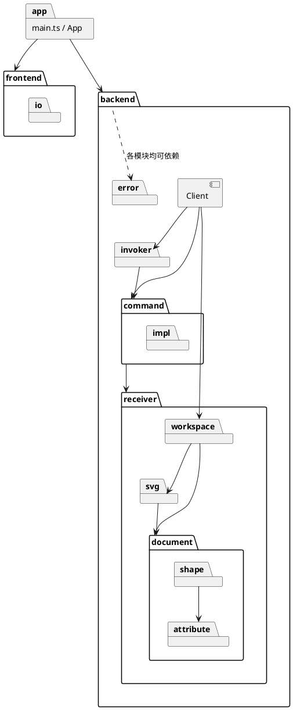

# SVG Editor

## 项目背景

本项目是课程 Lab1 的工程实践：用 TypeScript 实现一个**命令行 SVG 编辑器**，在 REPL（提示符 `svg>`）中通过命令创建、编辑、组织矢量图形，并以标准 SVG 文件读写。

### 为什么是 SVG

SVG 是用 XML 文本描述矢量图形的格式：纯文本、树形结构（`<g>` 容器嵌套子图形），保存出的文件可直接在浏览器或 VSCode 中预览。它天然具备两个适合做架构练习的特征：

- **树形组合结构**：容器与叶子图形需要被统一操作（移动、缩放、设置属性、删除），是 Composite 语义的典型场景；
- **可寻址性**：图形以唯一 `id` 定位，使 CLI、agent、鼠标等不同输入通道都能无歧义地回答"改哪个图形"。

### 项目目标

功能本身不是考察重点，重点在于**与 AI 协作完成一个架构良好、恰当使用设计模式的应用**：

- **架构**：清晰的模块划分与依赖方向，识别并为变化点预留扩展余地；
- **设计模式**：编辑操作以 Command 模式实现，支持 undo / redo；图形树体现 Composite 语义；
- **编程范式**：面向对象（类层次 + 多态、字段封装、一类一文件），避免贫血模型与按类型名到处分派的过程式写法；
- **过程可追溯**：git 分步提交，记录与 AI 协作中的关键讨论、问题发现与纠正。

### 阶段规划

| 阶段 | 内容 |
| --- | --- |
| Phase 1 | CLI 编辑器内核：文档读写、六种内置图形（rect / circle / ellipse / line / text / g）、编辑命令、结构树显示、undo / redo |
| 后续阶段 | 插件化扩展，例如以 ShapeProvider 插件注册复合图形类型 `box`（带标题的矩形框），内核无需改动 |

### 使用方式

```bash
npm install
npm run cli                  # 交互运行（提示符 svg>）
npm run cli < script.txt     # 脚本回放：逐行回显命令与结果
npm test                     # 单元测试 + 端到端测试
npm run typecheck            # 类型检查
npm run coverage             # 覆盖率报告
```

各阶段需求见 [prd/](prd/)，每次开发的提案、决策与验证记录见 [update/](update/)。

## 架构方案

### 1. 模块划分

代码分为前端与后端两大块，由 App 负责两者之间的通信与数据转换；后端按命令模式的角色分包，Receiver 再按领域细分。

| 模块（目录） | 职责 |
| --- | --- |
| `src/main.ts` | 入口：扫描 `backend/command/impl/` 注册全部命令，组装控制台 IO、Client、App 后启动 |
| `src/App.ts` | 主循环：从前端读一条命令 → 交给后端执行 → 把结果交给前端展示；前后端之间唯一的转换点（参数数组交给后端，`CommandResult` 拆成字符串交给前端，两侧的错误统一输出） |
| `frontend/` | 读入与展示：读行、跳过注释与空行、分词（`Tokenizer`）、提示符与脚本回显（`CommandReader`）、`warning:` / `error:` 前缀与输出顺序（`ResultPrinter`）；只认字符串，不认识任何命令 |
| `frontend/io/` | 设备适配：`InputSource` / `OutputSink` 接口及控制台实现 |
| `backend/Client.ts` | 后端唯一入口（命令模式的 Client）：内置命令（help、undo、redo、exit、quit）与命令分发 |
| `backend/invoker/` | Invoker：执行命令，维护撤销 / 重做历史与"文档类命令后禁止撤销"的规则 |
| `backend/command/` | Command 基类、类别基类（`EditCommand` 可撤销、`DocumentCommand` 文档类、`RelocateCommand` 移动位置）与 `CommandResult` |
| `backend/command/impl/` | ConcreteCommand：一个命令形式一个类（共 17 个），启动时自动注册 |
| `backend/receiver/workspace/` | 编辑会话的接收者上下文：当前文档槽位及其文件路径（"无文档"只在这里判定）、图形工厂、文件读写 |
| `backend/receiver/document/` | 图形树：画布根 `Document`、`Container` 接口、子节点序列 `ChildList` |
| `backend/receiver/document/shape/` | Shape 类层次（Composite）、图形工厂 `ShapeFactory`、属性快照 `ShapeMemento` |
| `backend/receiver/document/attribute/` | 属性种类（解析、约束、展示、平移、缩放、默认值）与数值文本规则 `DecimalFormat` |
| `backend/receiver/svg/` | SVG 序列化 `SvgWriter`、解析 `SvgReader`、文件读写 `SvgFile` |
| `backend/error/` | 后端异常 `EditorError`，位于依赖最底层 |



### 2. 设计模式的选择

| 模式 | 解决的问题 | 落地 |
| --- | --- | --- |
| **Command**（课程要求） | 编辑操作要可撤销、可重做，且所有操作统一执行 | Client = `Client`（按名创建命令）；Invoker = `Invoker`（执行，维护撤销栈与重做栈）；Command = `Command`；ConcreteCommand = `command/impl/` 下的 17 个类；Receiver = `Workspace`、`Document`、Shape 树、`SvgFile`。命令在构造时解析参数，在 `execute` 中取文档并执行，撤销所需的信息记在命令自己身上，所以撤销栈里存的就是命令对象；redo 即再次 `execute()` |
| **Composite**（课程要求） | 容器与叶子统一操作 | `Shape` 为 Component，`Group` 为 Composite，`Rect` 等 5 个类为叶子；`Document` 作为画布根同样实现 `Container`。`find`、`move`、`scale`、`capture`、`relocate` 对容器与叶子一视同仁，Group 覆盖为"自身 + 递归子节点"；命令只调用 `shape.move()` 等，不判断类型 |
| **Strategy**（属性种类） | 不同属性的取值规则不同，但 set / show / save / move / scale 要对属性统一处理 | `AttributeSpec` 及其子类（坐标、尺寸、线宽、字符串、文本内容）封装解析、约束、展示、平移、缩放、默认值；各图形类以静态属性表声明自己有哪些属性、各属哪一种类。叶子类因此只有声明，没有按属性名的分支 |
| **Factory（注册表）** | 按类型名创建图形，插件类型可加入 | `ShapeFactory`：类型名 → 图形类；create 用 `lookup`，read 用 `find`；按名分派标注为待重构（见一致性自查） |
| **Memento** | move / scale / set 的撤销要精确还原，浮点反向运算做不到 | `Shape.capture()` 生成 `ShapeMemento`（容器连同子树），恢复动作以闭包保存私有属性，属性值不对外暴露 |
| **Template Method** | front、back、addto 的流程相同，只是目标不同 | `RelocateCommand`：记下原位置 → relocate 到目标 → 撤销时 relocate 回去；子类只给出目标与回显 |

"静态成员即定义、构造函数即工厂"是贯穿全项目的写法：命令类以静态 `command` / `usage` / `accepts` 自描述，图形类以静态 `type` / `params` / `paint` / `anchor` / `content` 自描述。注册时统一校验，漏写或写错在启动时就会失败。

### 3. 依赖方向规则

| # | 规则 | 理由 |
| --- | --- | --- |
| 1 | `App` 可依赖 frontend 与 backend；**frontend 与 backend 互不依赖**，也没有共享模块 | 前后端只经由 App 通信，更换输入通道（agent、脚本）或展示方式时另一侧不受影响；共享模块会掩盖反向依赖（见过程记录第 1 条） |
| 2 | backend 只有 `Client` 对外；Client 可依赖 invoker、command、receiver/workspace | Client 是后端唯一入口，负责分发命令，并把 Receiver 交给命令 |
| 3 | invoker 只依赖 command（含 EditCommand、DocumentCommand 两个类别基类） | Invoker 只管执行与历史，不认识任何 Receiver |
| 4 | command 可依赖 receiver；**receiver 不得依赖 command、invoker、Client** | 领域模型不知道自己被谁操作，可以脱离命令单独测试与复用 |
| 5 | receiver 内部：workspace → document、svg；svg → document；**document 不依赖 svg、workspace**；shape → attribute | 图形树是最核心的领域，文件格式与会话状态都建立在它之上 |
| 6 | `backend/error` 可被所有后端模块依赖，自身不依赖任何模块 | 各层都会做业务校验，错误类型必须位于最底层 |
| 7 | 第三方与系统依赖收口：`@xmldom/xmldom` 只在 `SvgReader` 中使用，`node:fs` 只在 `SvgFile` 与 `main.ts` 中使用 | 更换解析库或文件访问方式时只改一个类 |

### 4. 变化点假设

| 变化点 | 预留 / 不预留的理由 |
| --- | --- |
| 新图形类型（后续阶段的插件 `box`） | **已预留**：图形类只需声明 `type`、`params`、`paint`、`anchor`、`content`，create、显示、平移缩放、set、读写全部按声明通用处理；`ShapeFactory.register` 已开放，注册时校验声明。待做：ShapeProvider 插件的注册入口，以及 box 的 set 传播、不可 ungroup 等插件语义 |
| 新命令 | **已预留**：在 `command/impl/` 加一个文件即被自动注册；同一命令名的多种形式由各形式的 `accepts` 按参数结构唯一命中（如 `canvas` 与 `canvas <w> <h>`），不依赖注册顺序。待做：内核之外的插件命令注册入口 |
| 新属性种类（如带单位的长度） | **已预留**：新增 `AttributeSpec` 子类，实现解析、约束、展示、平移、缩放、默认值即可，其余代码不改 |
| 新输入输出通道（agent、文件脚本、GUI） | **已预留**：`InputSource` / `OutputSink` 接口；前后端以"参数数组 + 结果字符串"为边界，命令文本是唯一协议 |
| XML 解析实现 | **已预留**：依赖只出现在 `SvgReader` 一个类中 |
| 新的命令类别（撤销规则） | **不预留**：Invoker 按类型分两支（编辑类、文档类），行为只有这两种，集中在一处最直观；新增类别时在 Invoker 加分支（开发者决策） |
| 文件系统抽象 | **不预留**：只有一种实现，测试直接使用临时目录；需要时再从 `SvgFile` 提取接口 |
| 外部 SVG 的完整支持（未知属性、单位、不支持的元素） | **不预留**：read 的定位是读回本编辑器保存的文件与简单的外部文件，复杂内容跳过或丢弃，记为已知限制 |
| 画布尺寸不声明 / 百分比尺寸 | **不预留**：课程规定画布为数值尺寸，支持它需要改动文档生命周期与显示，留到后续阶段 |

## 过程记录

开发按"需求文档（[prd/](prd/)）→ 提案（[update/](update/)）→ 开发者逐条确认决策 → 分步开发与提交 → 补齐测试与验证"的流程推进，共 8 份需求、9 份提案（含 1 份重构）。以下记录有代表性的讨论与纠正，细节见对应提案的"决策记录"。

1. **去掉 common 模块**（[REFACT_REMOVE_COMMON](update/20261016_REFACT_REMOVE_COMMON.md)）。框架提案设立了前后端共享的 `common`，里面只有 `CommandResult` 与 `EditorError` 两个类。落地后复查发现，这两个类实际都属于后端，前端经由 `common` 依赖了后端类型，"前后端互不依赖"的规则只是被目录名掩盖了。纠正：去掉 common，`CommandResult` 归入 command，`EditorError` 独立为最底层的 error，前端改用自有的 `ParseError`，由 App 负责转换。
2. **"无文档"在哪里判定**（[DOCUMENT_CANVAS](update/20261016_FEAT_DOCUMENT_CANVAS.md)）。AI 给出三个方案：命令静态声明、由 Client 检查；各命令自查；只由 Workspace 判定。开发者选择最后一个：有无文档是 Receiver 的状态，不应泄露到 Client 与命令。代价是放宽了框架中"无文档先于参数格式报错"的约定，PRD 随之修改。
3. **图形属性如何建模**（[SHAPE_CREATE_DELETE](update/20261020_FEAT_SHAPE_CREATE_DELETE.md)）。对比了三种写法："类型化字段"（每个叶子都要按属性名写 switch）、"静态属性表 + 属性种类"、"字段装饰器"。对装饰器在工具链上做了最小验证，发现 vitest 无法转译、tsc 需要改 lib 配置、运行时还缺 `Symbol.metadata`，于是选择静态属性表。之后开发者追问属性种类按什么维度抽象，AI 发现自己最初列的四个种类划分不一致：stroke-width 被归入尺寸，但两者的缩放行为不同；fill 与 text 内容的行为完全相同，却分成了两类。据此改为按"至少一项操作的行为不同才拆分"重新划分。静态成员 `geometry` 也因为 text 的内容不是几何属性，改名为 `params`。
4. **取值与展示分离**（[DISPLAY](update/20261020_FEAT_DISPLAY.md)）。AI 最初让 TextSpec 的 `format` 直接给文本加引号，这样 save 取到的也会是带引号的值。开发者指出取属性应当取真值，展示应使用独立的方法；随后又追问"format 是否多余"。最终由 `Shape.value(name)` 取原值，属性种类只保留展示用的 `display`。
5. **tree 的格式**（DISPLAY）。AI 推荐按最长的标签对齐属性列，以吻合课程示例；核对课程原文后发现示例本身就没有严格对齐，开发者改为固定空 2 格。开发者还指出 `w=`、`(x1,y1) -> (x2,y2)` 等缩写有歧义，于是 tree 统一输出必填属性的全名，完整属性由 show 提供。
6. **Invoker 如何区分命令类别**（[UNDO_REDO](update/20261020_FEAT_UNDO_REDO.md)）。AI 推荐双分派（`recordTo` + History 接口），并声称在 Invoker 中用 `instanceof` 属于课程禁止的写法。开发者追问后核对原文，课程禁止的是"到处 `switch(tag)`"，AI 的说法过于严格。开发者决定由 Invoker 直接按类型分两条分支，History 接口随之取消。讨论中又暴露出 `canvas` 一个类既是显示类又是文档类的问题；开发者指出它们本来就是两条命令，于是拆成两个类型。Client 在同名的形式中按 `accepts` **唯一命中**来选择，而不按注册顺序取第一个，因为注册顺序由文件名排序决定，不能作为优先级的依据。
7. **move 回显的锚点**（[TRANSFORM_SET](update/20261020_FEAT_TRANSFORM_SET.md)）。AI 最初用"取第一个 x 坐标与第一个 y 坐标"的通用规则。开发者指出这条规则没有保障：它依赖声明顺序，写错了也不会报错。于是改为各类显式声明 `anchor`，注册时校验。撤销方式选用备忘录而不是反向运算，因为浮点数先乘 3 再乘 1/3 不能精确还原。
8. **不必要的抽象**（[HIERARCHY_ZORDER](update/20261021_FEAT_HIERARCHY_ZORDER.md)）。AI 参照属性快照，提出新增位置备忘录类 `Placement`。开发者追问是否必要，确认父节点与位置本来就能公开取得，不像属性快照那样受封装约束，单独建类只是给一个三元组起名，于是取消。同一需求中，课程原文对"根级容器能否 ungroup"前后矛盾，且没有会话样例；开发者了解代价后，选择照 §4.2 的明文拒绝。
9. **范围收窄**（[SVG_FILE_IO](update/20261021_FEAT_SVG_FILE_IO.md)）。AI 的方案为任意外部 SVG 做了较多兼容，例如保留未知属性、识别 `px` 单位。开发者追问"需要支持这么多文件类型吗"，核对后确认课程只要求读回自身保存的文件与示例 `other.svg`，于是收窄范围，并改动了已确认的一项 PRD 决策。引入 `@xmldom/xmldom` 前做了验证，发现它默认把解析错误打印到 stderr，因此改用 `onError` 收集错误，再转为 `EditorError`。
10. **文档中的数据错误**。收尾核对时发现，4 份提案"测试与验证"中的测试文件数是 AI 估写的，并非取自实际输出。已按当时提交中的实际文件数逐一改正。此后文档中的数字一律取自命令输出。

## 一致性自查

### 模块划分

实际目录与方案一致。与框架提案（[CLI_REPL](update/20261016_FEAT_CLI_REPL.md)）中的预期目录相比，不一致之处均已在对应提案中记录：

| 差异 | 原因 | 记录 |
| --- | --- | --- |
| 去掉 `common/` | 共享模块掩盖了前端对后端的依赖 | REFACT_REMOVE_COMMON |
| `backend/error/` 独立成包 | EditorError 必须位于依赖最底层，而 receiver 不能依赖 command | REFACT_REMOVE_COMMON |
| `document/` 下细分 `shape/`、`attribute/` | 图形类层次与属性种类各自成组 | SHAPE_CREATE_DELETE |
| `command/` 下新增 `EditCommand`、`DocumentCommand`、`RelocateCommand` | 可撤销、文档类、移动位置三个类别基类 | SHAPE_CREATE_DELETE、UNDO_REDO、HIERARCHY_ZORDER |
| 删除 `PlaceholderCommand` | 全部命令已有真实实现 | SVG_FILE_IO |

### 依赖方向

全部需求完成后（2026-10-24），针对第 3 节的每条规则检索 `src/` 中的 import，结果如下：

| 规则 | 检查方式 | 结果 |
| --- | --- | --- |
| frontend 与 backend 互不依赖 | frontend 中 import backend / App；backend 中 import frontend / App | 0 处 |
| receiver 不依赖 command、invoker、Client | receiver 中 import `/command/`、`/invoker/`、`Client` | 0 处 |
| invoker 只依赖 command | invoker 中 import receiver、Client | 0 处 |
| command 不依赖 invoker、Client | command 中 import invoker、Client | 0 处 |
| document 不依赖 svg、workspace | document 中 import `/svg/`、`/workspace/` | 0 处 |
| 第三方与系统依赖收口 | 检索 `xmldom`、`node:fs` | `xmldom` 只在 SvgReader 中；`node:fs` 只在 SvgFile 与 main.ts 中 |

command → receiver 属于允许的方向：Command 基类使用 `DecimalFormat`（命令参数与数值属性共用同一份数值规则），RelocateCommand 使用图形树的类型。

### 按名分派

编码约束要求：按名字分派只允许出现在命令分发和图形工厂两处，并须标注为待重构。

项目中按名字选择行为的地方只有下面两处。两处都位于"文本 → 对象"的边界：用户输入的是文本，总要有一处把名字翻译成对象；翻译完成后，所有行为都由多态完成，不再查看名字。

"待重构"的含义：查表本身不改，要改的是表里的条目由谁登记。现在所有条目都写在内核代码里，新增一个类型就得改内核；以后应当由新类型自己登记进来，内核不用动。例如后续阶段新增 `box` 时，由 box 插件自己调用 `factory.register(Box)`，而不是去改 ShapeFactory。这对应课程中 phase1 允许暂缺的"插槽"。

| 位置 | 名字 → 对象 | 翻译之后 | 待重构：条目由谁登记 |
| --- | --- | --- | --- |
| `Client.execute`（[Client.ts](../src/backend/Client.ts)） | 命令名 → 内置命令 / ConcreteCommand 类；同名多形式（如 `canvas` 与 `canvas <w> <h>`）由各形式的 `accepts` 按参数结构唯一命中 | 命令对象自己解析参数、执行、撤销；Invoker 只认抽象 `Command` | 现状：`main.ts` 扫描 `command/impl/` 自动注册，新增内核命令不改 Client。待重构：内核之外的插件命令目前无法注册，需开放注册插槽 |
| `ShapeFactory.lookup`（[ShapeFactory.ts](../src/backend/receiver/document/shape/ShapeFactory.ts)） | 图形类型名 → 图形类（create 按类型参数、read 按元素名使用；read 用 `find` 查询，未注册时跳过） | 查找、删除、撤销，以及平移、缩放、显示、序列化，都由 Shape / Group 的覆盖和属性种类的多态完成 | 现状：内置 6 类写死在工厂的构造函数中。待重构：插件阶段改为由 ShapeProvider 各自注册，工厂只负责查表 |

以下几处也比较了名字或字符，但都不是按名分派：

| 位置 | 内容 | 不属于按名分派的原因 |
| --- | --- | --- |
| `Shape.attribute(name)` | 按属性名在图形类声明的属性表中查找属性种类 | 查的是数据（属性表条目），不依据图形类型选择行为；取到的属性种类再以多态完成解析与校验 |
| `CreateCommand` | 识别 `in` 关键字 | 语法解析 |
| `Tokenizer` / `CommandReader` | 字符比较（引号、空行） | 词法处理 |
| `UngroupCommand` | `shape.parent() === doc` 判断根级容器 | 对象同一性比较，不判断类型、不比较名字 |
| `SvgReader` | 根元素须为 `svg`；跳过非元素节点（文本、注释） | 文件格式校验与 DOM 节点分类，不选择图形行为 |
| `SvgWriter` | `typeof value === 'number'` 决定属性原值的文本形式 | 属性值类型（number \| string）的收窄，不是按图形类型分派 |
| `CoordinateSpec.translate` | 按自身的轴取 dx 或 dy | 二选一取数据，平移行为本身不变；坐标与其他属性的行为差异由属性种类的多态承担 |
| `App` | 用 `instanceof` 区分可报告的错误与程序缺陷 | 错误分类，不选择业务行为 |

以下一处按类型（而非名字）选择行为，属于开发者决策（见 [UNDO_REDO](update/20261020_FEAT_UNDO_REDO.md)）：

| 位置 | 内容 | 说明 |
| --- | --- | --- |
| `Invoker.execute`（[Invoker.ts](../src/backend/invoker/Invoker.ts)） | 用 `instanceof` 分两支：EditCommand 入撤销栈，DocumentCommand 清空历史并禁止 undo / redo | 行为只有两条分支，集中在 Invoker 一处，不是课程禁止的"到处 `switch(tag)`"；新增命令类别时需在此增加分支 |

自查方式：以 `switch`、与字符串字面量的比较、`Map.get`、`instanceof`、`typeof` 为关键词检索 `src/`，逐条归类。每个需求完成时都做了复查，最近一次在全部需求完成后（2026-10-24）。

## 质量保证手段

### 功能完整性

- **需求可追溯**：8 份 PRD 的每一条 case（正常、边界、异常）都在对应提案的"测试与验证"表中列出了用例与验证方式；课程原文中有歧义或缺失的地方，都记入 PRD 的"决策记录"，由开发者确认。
- **端到端验证**：[test/main.test.ts](../test/main.test.ts) 以子进程运行真实入口，按脚本回放逐条比对回显，覆盖 10 组场景：框架、文档与画布、创建删除、显示、撤销重做、平移缩放设置、层级与 z-order、文件读写等，并断言 stderr 为空。文件读写场景使用临时目录，读入的正是课程给出的 `other.svg`。
- **与课程示例逐字对照**：save 产物与课程的文件格式示例逐字一致；读入 `other.svg` 的警告、元素数与 tree 都与示例一致（见 SvgWriter / SvgReader 的测试）。

### 代码质量

- **测试**：`npm test` 共 39 个测试文件、411 个用例全部通过。每个类都有单元测试，测试目录与 `src/` 一一对应。总体覆盖率：语句 97.67%、分支 96.47%、函数 97.91%、行 97.71%。未覆盖的部分是入口 `main.ts`、控制台 IO 适配器（由子进程端到端测试间接覆盖），以及少数不会发生的防御性分支。
- **类型检查**：TypeScript `strict`，并开启 `noImplicitOverride`、`noUnusedLocals`、`noUnusedParameters`；`npm run typecheck` 无错误。
- **撤销的精确性**：每个可撤销命令都测试了"执行 → undo 后状态与执行前一致 → redo 回显与首次相同"；move / scale 专门用浮点坐标验证 undo 后原值逐位相同。
- **启动即失败**：命令名或语法缺失、同名多形式未声明 `accepts`、图形类型名缺失或重名、锚点不是坐标属性等程序缺陷，都在注册时直接抛出，不会留到运行时。
- **一致性自查**：每个需求完成后，用"关键词检索 + 逐条归类"复查按名分派与依赖方向（见上一节）。
- **过程约束**：决策点全部确认后才进入开发；git 历史按"文档 → 分步实现 → 测试 → 补齐文档"推进，每个需求在功能分支上开发后合并，没有 one-shot 大提交。

### 已知限制

- 根级容器不可 ungroup（按课程 §4.2）：画布根下 group 出来的容器只能通过 undo 解散。
- 读入外部文件时，不支持的元素被跳过、未知属性被丢弃，svg 根元素上的其他属性不保留，再次保存时这些内容会丢失；只有 viewBox 的文件保存后会带上明确的 width / height。
- `scale` 以坐标原点为中心，图形的位置会随之变化。
- 回显未做单复数处理（如 `1 children`）。
