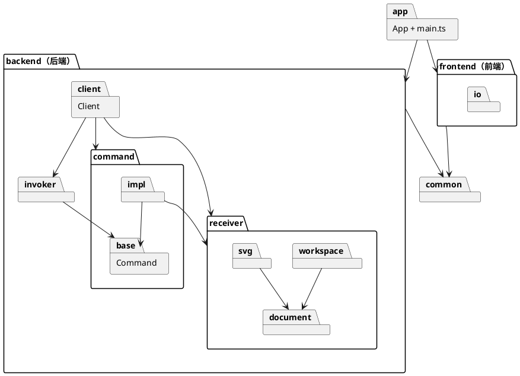
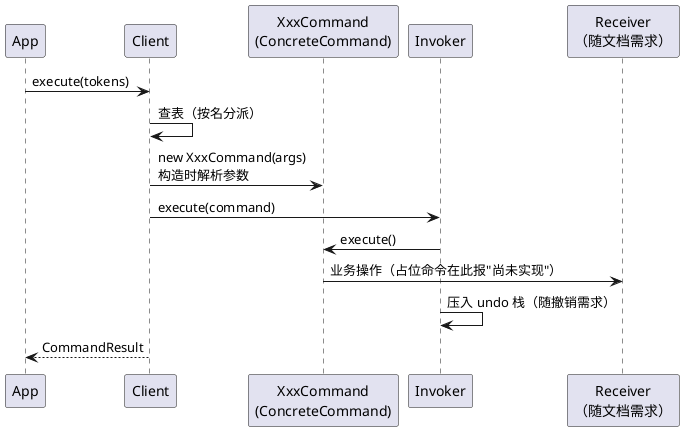

# FEAT：命令行交互框架（REPL）

- 提案时间：2026-10-16
- 完成时间：2026-10-16
- 类型：FEAT
- 关联 prd：doc/prd/phase1/20261016_CLI_REPL.md

<!-- 提案阶段：动因、决策记录、数据模型、架构 / 流程设计，讨论确认后方可进入开发 -->

## 动因

本次实现 CLI_REPL 需求，具体包括：启动横幅、提示符、注释与空行、分词、报错优先级、结果 / 警告 / 错误输出、数值输出格式、通用参数校验、脚本回放时的回显，以及 help / exit / quit；全部命令以占位形式注册。

仓库目前没有任何代码，因此还需要同时完成两件事：

- 搭建 TS 工程；
- 确定整体的模块划分（前端 frontend / 后端 backend / App 负责两者通信）以及 backend 内按命令模式角色的分包，并让 Client → Invoker → ConcreteCommand 的链路由占位命令在运行时跑通，保证后续命令按同一结构替换落地。

## 决策记录

| 议题 | 选项 | 决定 | 理由 |
| --- | --- | --- | --- |
| 运行方式 | A：tsx 直接运行；B：tsc 编译后 node 运行；C：ts-node | A | 免编译、启动快；`tsc --noEmit` 只做类型检查 |
| 测试框架 | A：Vitest；B：Jest；C：node:test | A | 原生支持 TS / ESM，零配置，自带覆盖率 |
| 模块划分 | A：前端 frontend + 后端 backend + App 负责通信 + 共享的 common；B：按技术角色平铺（cli / session / command / param） | A | 前后端互不依赖，只由 App 编排；后端自成一体，Client 是它唯一的对外入口 |
| 前后端包命名 | A：frontend / backend；B：cli / core；C：display / core | A | 直观，名字即职责；cli、display 只描述了前端的一部分职责 |
| 前后端边界 | A：文本边界，frontend 交出分词后的参数数组，backend 返回执行结果；B：结构化边界，frontend 负责全部文本处理，backend 暴露类型化接口与结构化结果 | A | agent 通道同样使用命令文本；插件类型（如 box）的参数与显示只需在后端登记一处；undo 回显依赖命令内部记录的旧值 |
| 主循环归属 | A：App 负责主循环，frontend 只提供 IO、读入与展示能力，backend 只提供执行能力；B：frontend 负责主循环并调用后端 | A | frontend 与 backend 解耦；App 写成类，便于用内存 IO 做端到端测试；`main.ts` 只负责组装 |
| IO | A：抽象成输入源 / 输出接口；B：直接使用 console / readline | A | 测试时可用内存实现回放；为 agent 等通道预留变化点 |
| backend 内的分包方式 | A：按命令模式角色分包（Client / invoker / command / receiver）；B：按层分包（协议 / 应用 / 领域 / 基础设施）；C：按技术角色平铺（action / command / param / model） | A | 项目以面向对象 + 命令模式为核心，角色即模块，依赖方向直接取自模式结构；B 在"命令自带定义与回显"的前提下会塌缩成三层；C 看不出模块间的上下关系 |
| 后端入口命名 | A：Client；B：EditorSession | A | 与命令模式的角色名一致 |
| help / exit / quit / undo / redo 的归属 | A：Client 的方法；B：一操作一类（SessionAction 类层次） | A | 它们操作的是会话自身（命令表、历史、生命周期），不属于命令模式的角色；为其单独建类层次属于过度抽象 |
| Invoker 的落地 | A：独立的 Invoker 类（invoker/）；B：内联在 Client 中 | A | undo / redo 必然到来，角色先独立；历史栈与 io 命令后禁止撤销的规则随撤销需求补入 |
| 命令模式角色的落地程度 | A：Client / Invoker / Command 真实实现，ConcreteCommand 全部以占位类落地，Receiver 随文档需求落地；B：首批命令（init / canvas）连同 Receiver 真实实现；C：只写骨架，不注册任何命令 | A | 单次交付范围小；占位命令让链路在运行时可用，help 从第一天起完整 |
| 占位命令的实现方式 | A：抽象基类 `PlaceholderCommand`（继承 Command，执行时报"尚未实现"），每个命令一个子类文件，只声明命令名与 usage；B：单个占位类按命令名实例化多次（集中的命令表） | A | 一类一文件；替换为真实实现时只改该命令自己的文件，改为直接继承 Command；B 需要集中表，与"新增命令只需加文件"冲突 |
| 定义与实例 | A：分离；B：单类 + 原型克隆 | A | 每次执行都是独立对象，可以直接压入 undo 栈 |
| 定义的写法 | A：类的静态成员即定义（命令名、usage），构造函数即工厂；B：独立的定义类；C：装饰器 | A | 一命令一类 |
| 静态部分的约束方式 | A：作为 Command 基类的静态成员，子类覆盖，注册时做运行时校验；B：单独定义描述类静态部分的接口 | A | 概念更少。TS 不支持 `abstract static`，漏写时由注册阶段的检查兜底，启动即失败 |
| 参数解析 | A：ConcreteCommand 在构造函数中自行解析，通用格式校验（个数、数字）作为 Command 基类的 protected 方法；B：命令声明参数规格，由通用逻辑解析 | A | 先按简单的做；参数规格对象目前没有第二个使用者 |
| 结果输出 | A：后端返回执行结果，失败时抛异常，由 App 交给 frontend 打印；B：命令直接写输出接口 | A | 后端不依赖 IO；失败时不会已经输出了半截内容 |
| 结果的形态 | A：结果对象 `CommandResult`（common），分别收集警告与结果行，`warning:` 前缀由 ResultPrinter 统一添加，警告先于结果行输出；B：后端直接返回带 `warning:` 前缀的字符串行 | A | 前缀规则与 `error:` 一样只在前端一处；后端不关心输出格式 |
| Command 基类本次是否声明 `undo()` | A：本次只声明 `execute()`，`undo()` 随首个可撤销命令（create）与撤销需求引入；B：现在就声明抽象 `undo()`，占位命令给出抛错实现 | A | 占位命令与文档类命令都不可撤销，避免写无意义的实现 |
| 编辑命令的扩展方式 | A：ConcreteCommand 自描述（静态 `command` / `usage`），启动时扫描 `impl/` 注册；B：集中的契约表 | A | 新增命令只需加文件，对扩展开放 |
| ConcreteCommand 目录 | A：`src/backend/command/impl/`；B：`src/backend/command/plugins/`；C：独立的顶层目录 | A | 归属 command 角色，不散落在外；impl 表明其为 Command 的实现 |
| ConcreteCommand 的形态 | A：数据与行为同在一个类（GoF）：静态成员是定义，实例字段是本次记录，execute / undo 是执行方法；B：统一记录 `{name, args}` + 无状态处理器 | A | B 的记录是贫血模型，undo 状态无法精确定型，且 undo / redo 需要按名字找回处理器，多出一处按名分派 |
| Receiver 交给命令的方式 | A：ConcreteCommand 构造时持有 Receiver（GoF 标准形态）；B：执行时由 Invoker 传入 | A | Invoker 只管执行与历史，不需要知道 Receiver；命令在 undo 时也能拿到 Receiver |
| receiver 的划分 | A：按领域分子包（workspace / document / svg）；B：单一 model 包 | A | 三者变化来源不同：当前文档槽位、图形树规则、文件格式；跨领域的编排由 ConcreteCommand 完成 |
| 提示符高亮的判定 | A：由输出端声明是否支持彩色（`OutputSink.colorful`），CommandReader 据此选择提示符；B：CommandReader 直接检测 stdout | A | 是否支持颜色是输出设备的属性；CommandReader 不依赖控制台，内存输出端可直接测试两种情况 |

## 数据模型

### 命令模式角色

| 角色 | 类 | 位置 | 本次状态 |
| --- | --- | --- | --- |
| Client | `Client` | backend | 实现：内置命令、命令表、按名分派、创建 ConcreteCommand 并交给 Invoker |
| Invoker | `Invoker` | backend/invoker | 实现：`execute(command)`；undo / redo 栈随撤销需求补入 |
| Command | `Command` | backend/command | 实现：静态 `command` / `usage`；抽象方法 `execute(): CommandResult`；通用格式校验与数值格式化 |
| ConcreteCommand | `InitCommand` … `ShowCommand`（16 个） | backend/command/impl | 占位：继承 `PlaceholderCommand`；由各命令需求逐个替换为真实实现 |
| Receiver | `Workspace`、`Document` 等 | backend/receiver/* | 随文档需求起逐步落地 |

### 其他类

| 位置 | 类 / 接口 | 职责 |
| --- | --- | --- |
| src | `App` | 前后端通信与主循环：打印横幅 → 从 `CommandReader` 读一条命令 → 交给 `Client` 执行 → 用 `ResultPrinter` 打印结果或错误 → 请求退出或读到 EOF 时结束 |
| src | `main.ts`（入口脚本） | 扫描 `backend/command/impl/` 并逐个注册到 `Client`；组装控制台 IO、`Client`、`App`，然后调用 `run()` |
| frontend | `CommandReader` | 读取下一条命令：交互模式下打印提示符，脚本模式下回显 `svg> <原始行>`；跳过注释与空行；分词后返回参数数组，遇到 EOF 返回 null |
| frontend | `Tokenizer` | 按空白分词；双引号内的内容算一个参数；引号未闭合时抛 `EditorError` |
| frontend | `ResultPrinter` | 打印横幅；打印 `CommandResult`：先逐条输出 `warning: <消息>`，再输出结果行；打印 `error: <消息>` |
| frontend/io | `InputSource`（接口） | `next(): Promise<string \| null>`；`interactive` 表示是否交互模式 |
| frontend/io | `OutputSink`（接口） | `writeLine(text)`；`colorful` 表示是否支持彩色输出（提示符高亮用） |
| frontend/io | `ConsoleInputSource` / `ConsoleOutputSink` | 控制台实现：基于 readline，用 `stdin.isTTY` 判断是否交互；stdout 为终端且 `hasColors()` 为真时视为彩色输出 |
| backend | `Client` | 后端唯一入口。持有 `Invoker`、内置命令表（命令名 → 自身方法及 usage）、ConcreteCommand 表和退出标志；`register(cls)` 校验命令名与 usage 非空、不与内置命令及已注册命令重名；`execute(tokens): CommandResult`；`isExitRequested()`；内置命令 `help`（按命令表顺序列出全部 usage）、`exit` / `quit`（请求退出）、`undo` / `redo`（本次占位，报"尚未实现"） |
| backend/command | `Command` | protected 方法：`expectArgCount(args, ...allowed)`（个数不符时报错并附 usage）、`parseNumber(token)`、`formatNumber(n)`（整数不带小数点，浮点最多 6 位小数并去掉末尾 0，`-0` 输出 `0`） |
| backend/command | `PlaceholderCommand` | 抽象占位基类：构造时不解析参数，`execute()` 抛出"命令尚未实现" |
| common | `EditorError` | 前后端共用的编辑器异常，消息即问题描述 |
| common | `CommandResult` | 一条命令的执行结果：`warn(message)`、`line(text)` 收集；`warnings()`、`lines()` 按加入顺序读取 |

示例写法：

```ts
// 占位（本次）
export default class MoveCommand extends PlaceholderCommand {
  static readonly command = 'move';
  static readonly usage = 'move <id> <dx> <dy>';
}

// 替换为真实实现后（随 TRANSFORM_SET，此处仅示意）
export default class MoveCommand extends Command {
  static readonly command = 'move';
  static readonly usage = 'move <id> <dx> <dy>';

  private readonly dx: number;
  private readonly dy: number;

  constructor(/* Receiver 随文档需求确定 */ args: string[]) {
    super();
    this.expectArgCount(args, 3);              // 个数不符时报错并附 usage
    this.dx = this.parseNumber(args[1]);
    this.dy = this.parseNumber(args[2]);
  }

  execute(): CommandResult { /* 调用 Receiver 平移图形 */ }
}
```

## 架构 / 流程设计

### 预期目录

标"（后续）"的文件由后续需求落地，本次不创建，仅示意位置。

```text
svg-editor/
├── package.json                    scripts：cli / test / typecheck / coverage
├── tsconfig.json
├── vitest.config.ts
├── src/
│   ├── main.ts                     入口：扫描 impl/ 注册命令，组装并启动 App
│   ├── App.ts                      前后端通信与主循环
│   ├── frontend/                   前端：读入、分词、展示
│   │   ├── CommandReader.ts
│   │   ├── Tokenizer.ts
│   │   ├── ResultPrinter.ts
│   │   └── io/                     设备适配
│   │       ├── InputSource.ts
│   │       ├── OutputSink.ts
│   │       ├── ConsoleInputSource.ts
│   │       └── ConsoleOutputSink.ts
│   ├── backend/                    后端，按命令模式角色分包
│   │   ├── Client.ts               Client：唯一对外入口，内置命令 + 按名分派
│   │   ├── invoker/
│   │   │   └── Invoker.ts          Invoker：执行命令（后续：undo / redo 栈）
│   │   ├── command/
│   │   │   ├── Command.ts          Command 基类
│   │   │   ├── PlaceholderCommand.ts  占位基类（全部命令替换完成后删除）
│   │   │   └── impl/               ConcreteCommand，启动时扫描
│   │   │       ├── InitCommand.ts
│   │   │       ├── …               共 16 个，命令表见 prd
│   │   │       └── ShowCommand.ts
│   │   └── receiver/               Receiver，按领域分子包（后续）
│   │       ├── workspace/          当前文档槽位、文件路径、无文档判定
│   │       ├── document/           画布 + 图形树、Shape 类层次、ShapeFactory
│   │       └── svg/                SVG 读写、文件读写
│   └── common/                     前后端共享
│       ├── EditorError.ts
│       └── CommandResult.ts
└── test/                           目录结构与 src 对应
    ├── App.test.ts                 端到端：用内存 InputSource / OutputSink 驱动
    ├── frontend/
    │   ├── CommandReader.test.ts
    │   ├── Tokenizer.test.ts
    │   └── ResultPrinter.test.ts
    ├── backend/
    │   ├── Client.test.ts          未知命令 / 占位命令 / 内置命令 / 注册校验 / help 全量列表
    │   ├── invoker/
    │   │   └── Invoker.test.ts
    │   └── command/
    │       └── Command.test.ts     通用格式校验与数值格式化（经测试桩命令）
    └── support/                    测试替身
        ├── MemoryInputSource.ts
        ├── MemoryOutputSink.ts
        └── StubCommand.ts          带参数、可产生警告的测试桩命令
```

### 模块与依赖方向



顶层规则：

- **frontend 与 backend 互不依赖**，两者之间的通信只经由 App；跨越边界的数据（`CommandResult`、`EditorError`）放在 common。
- frontend 和 backend 只能依赖 common；common 不依赖任何模块。
- frontend 内部：交互层（CommandReader / Tokenizer / ResultPrinter）只依赖 io 的接口，Console 实现只由 `main.ts` 引用。
- 不允许出现反向依赖或循环依赖。

backend 内部规则（依赖方向取自命令模式的结构，是一张有向无环图而非单链）：

| 模块 | 可依赖 | 理由 |
| --- | --- | --- |
| Client | invoker、command、receiver | Client 创建 ConcreteCommand、把 Receiver 交给它，再交给 Invoker 执行 |
| invoker | 仅 `command/Command.ts` | Invoker 只认抽象命令，不知道具体命令与 Receiver |
| command/impl | `command/Command.ts`、`command/PlaceholderCommand.ts`、receiver | ConcreteCommand 调用 Receiver；跨领域的编排（如 read = svg 读出 + workspace 替换）在这里完成 |
| receiver/workspace | receiver/document | 槽位中存放 Document |
| receiver/svg | receiver/document | 在 Document 与文件之间转换 |
| receiver/document | 无 | 领域核心，最稳定 |

### 命令模式协作



### 执行流程

`App.run()`：

1. 用 `ResultPrinter` 打印横幅。
2. 用 `CommandReader.next()` 读取一条命令：交互模式下打印提示符，脚本模式下回显原始行，跳过注释与空行，然后分词；遇到 EOF 返回 null，循环结束。
3. 调用 `client.execute(tokens)`，`CommandResult` 交给 `ResultPrinter` 打印（先警告，后结果行）。
4. 捕获 `EditorError`（分词或执行时抛出），由 `ResultPrinter` 打印 `error: <消息>`。
5. 若 `client.isExitRequested()` 为真，结束循环。

`Client.execute(tokens)`：

1. 先查内置命令表，再查 ConcreteCommand 表；都找不到时报"未知命令"。这是课程允许的按名分派点之一，标注为待重构。
2. 命中内置命令：校验参数个数（内置命令均无参数，多余时报错并给出 usage），然后调用对应方法。
3. 命中 ConcreteCommand：`new cls(args)`，构造函数中完成参数个数与格式校验（占位命令不解析参数）。
4. `invoker.execute(command)`：业务校验失败时由 `execute()` 抛出 `EditorError`；占位命令在此报"尚未实现"。

报错优先级由以上步骤的先后顺序自然保证：查表（未知命令）→ 构造（参数格式）→ 执行（业务校验）。"无文档"检查由文档需求插入第 1、3 步之间。

### 变化点

| 变化点 | 预留 |
| --- | --- |
| 占位替换为真实实现 | 只改该命令自己的文件：改为直接继承 Command，补全构造解析与 `execute()`；命令表与 help 不变。全部替换完成后删除 `PlaceholderCommand` |
| 新增命令 | 在 `backend/command/impl/` 中加 ConcreteCommand 文件，启动时自动扫描注册 |
| Receiver 引入 | 随文档需求确定 Client 构造 ConcreteCommand 的统一签名与"无文档"检查方式 |
| undo / redo | 可撤销命令在 Command 之下引入 `undo()`；历史栈与 io 命令后禁止撤销的规则加入 `Invoker`；Client 的 `undo` / `redo` 由占位改为转调 Invoker |
| 新的前端（agent / GUI） | 新增与 frontend 平级的前端模块，由 App（或新的通信类）与 backend 对接。目前前后端之间以参数数组和 `CommandResult` 交互，出现 GUI 前端时再增加结构化请求入口 |
| 新的文件格式 / 存储 | 局限在 `receiver/svg/`，document 不受影响 |
| 参数解析逻辑重复增多 | 目前由 Command 基类的 protected 方法承担；若出现可选颜色、`in` 子句等复杂语法，再考虑提取参数规格对象 |
| 命令序列化（历史记录 / 回放） | 可为 Command 增加 `toString()`，输出命令行形式的记录 |
| 按名分派 | 命令分发位于 `Client`，图形工厂位于 `receiver/document/ShapeFactory`（随 create），均标注为待重构 |

### 本次不做

- 全部 Receiver 与命令的真实实现：随各命令需求落地，首批为文档需求（init / canvas）；
- "无文档"判定：随文档需求落地；
- `undo()`、undo / redo 的真实实现与 Invoker 的历史栈：随撤销需求落地。

<!-- 开发阶段：补齐以下内容；上方已确认的决策不得改动 -->

## 测试与验证

`npm test`：8 个测试文件、64 个用例全部通过；`npm run typecheck` 无错误。

| 用例 | 验证方式 | 结果 |
| --- | --- | --- |
| 启动打印横幅 `svg-editor 0.1 — type 'help' for commands`，交互模式提示符 `svg> ` | 单元测试（ResultPrinter、CommandReader）+ 端到端（App 交互模式） | 通过 |
| 注释与空行不执行；脚本模式下注释行回显、空行不回显 | 单元测试（CommandReader）+ 端到端（App） | 通过 |
| `create text t1 20 40 "My Diagram"` 分词为 6 个参数，引号不计入值 | 单元测试（Tokenizer） | 通过 |
| `help` 列出全部 21 个命令及语法 | 子进程运行真实入口（main.test） | 通过 |
| `exit` / `quit` 后不再读取；EOF 结束；进程正常退出 | 端到端（App）+ 子进程（main.test） | 通过 |
| `npm run cli < script.txt` 不打印提示符，逐行回显 `svg> <原始行>` 后输出结果；CRLF 脚本与 LF 一致 | 子进程（main.test）+ 手工 | 通过 |
| 输出端支持彩色时提示符（含脚本回显）以粗体青色高亮；管道输出不含颜色控制符 | 单元测试（CommandReader）+ 子进程（main.test）+ 手工 | 通过 |
| 警告 `warning: <消息>` 先于结果行输出 | 单元测试（ResultPrinter）+ 端到端（App，经 StubCommand） | 通过 |
| 数字参数 `-10`、`0.5` 合法；`a`、`1e3`、`Infinity` 等报"不是数字" | 单元测试（Command，经 StubCommand） | 通过 |
| 数值输出 `130`、`0.1+0.2`→`0.3`、`-0`→`0`、最多 6 位小数 | 单元测试（Command） | 通过 |
| 占位命令（如 `move r1 10 0`）报"尚未实现"，与未知命令区分 | 单元测试（Client）+ 子进程（main.test） | 通过 |
| `foo` 报未知命令 | 单元测试（Client）+ 端到端 | 通过 |
| 参数个数不符时报错并附语法（含内置命令带多余参数） | 单元测试（Command、Client）+ 端到端 | 通过 |
| `create text t1 0 0 "abc` 报引号未闭合 | 单元测试（Tokenizer、CommandReader）+ 端到端 | 通过 |
| 任一命令失败只输出一行 `error: …`，之后继续读取 | 端到端（App） | 通过 |
| 注册校验：命令名 / usage 为空、与内置或已注册命令重名时启动即失败 | 单元测试（Client） | 通过 |

实现中补齐的细节（未改动已确认的决策）：

- `OutputSink` 增加 `write(text)`（不换行），用于输出提示符；
- `ConsoleInputSource` 增加 `close()`，由 `main.ts` 在主循环结束后调用，释放 stdin 使进程在 `exit` / `quit` 后正常结束；
- `main.ts` 按文件名排序扫描 `impl/`，因此 `help` 先按字母序列出 ConcreteCommand，再按 help、undo、redo、exit、quit 列出内置命令；
- 错误文案：`unknown command: <name>`、`command not implemented yet: <name>`、`wrong number of arguments. usage: <usage>`、`not a number: <token>`、`unclosed quote`。

## 遗留问题

- 控制台输入未启用 readline 的终端模式（否则 readline 重绘行时会抹掉由 CommandReader 输出的提示符），行编辑交给终端本身：无历史记录、方向键不可用；Windows 控制台下 EOF 为 Ctrl+Z 回车而非 Ctrl+D。若需要更好的交互体验，可由 InputSource 接管提示符，届时再讨论。
- `npm run cli` 会先输出 npm 自身的两行脚本信息（`> svg-editor@0.1.0 cli` 等），属于 npm 行为；需要纯净输出时使用 `npm run -s cli`。
- `main.ts` 的扫描逻辑与控制台 IO 不计入覆盖率（经子进程测试验证，覆盖率工具不统计子进程）。
