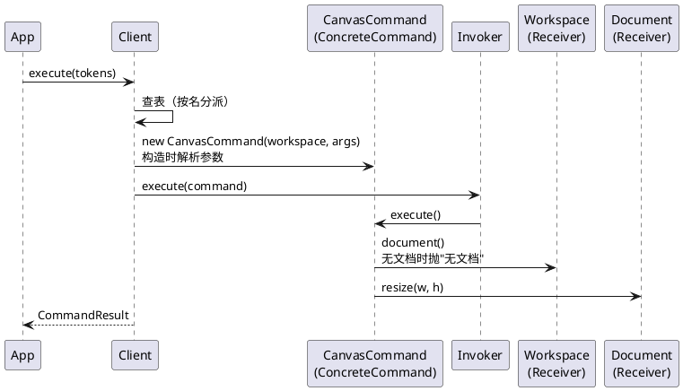

# FEAT：文档生命周期与画布

- 提案时间：2026-10-16
- 完成时间：（开发完成后填写）
- 类型：FEAT
- 关联 prd：doc/prd/phase1/20261016_DOCUMENT_CANVAS.md

<!-- 提案阶段：动因、决策记录、数据模型、架构 / 流程设计，讨论确认后方可进入开发 -->

## 动因

本次实现 DOCUMENT_CANVAS 需求：把 `init`、`canvas` 由占位替换为真实实现，并加入"无文档"约束。这是首个引入 Receiver 的需求，需要确定 Client 如何把 Receiver 交给 ConcreteCommand、"无文档"在哪里判定。

前置：CLI_REPL 已完成（框架、占位命令表、Command 基类的通用格式校验与数值格式化、`CommandResult` 的警告通道）。

## 决策记录

| 议题 | 选项 | 决定 | 理由 |
| --- | --- | --- | --- |
| Client 构造 ConcreteCommand 的统一签名 | A：`new cls(workspace, args)`，命令持有 Workspace，执行时从中取当前 Document；B：传入接收者集合对象（workspace、文件读写等） | A | 先按简单的做；本需求的命令只需要 Workspace，read / save 需要文件读写时再评估是否扩展 |
| "无文档"判定的位置 | A：ConcreteCommand 静态声明 `requiresDocument`，Client 在构造命令前统一检查；B：各命令在构造函数第一步自行检查；C：只由 Workspace 判定，`document()` 在无文档时抛错，命令在 `execute` 中取 Document，"无文档"并入业务校验 | C | 有无文档是 Receiver 的状态，不应泄露到 Client 与命令；规则只在 Workspace 一处，不需要额外概念；"参数格式先于无文档"由"构造时解析、执行时取文档"的结构保证。代价是放宽 CLI_REPL 的报错优先级（无文档不再先于参数格式） |
| 尺寸须为正数的校验归属 | A：Document 的不变量，构造与 `resize` 时校验（业务校验）；B：Command 基类新增 `parsePositive`，构造命令时校验（格式校验） | A | 领域对象自守约束，read 解析出的尺寸也经同一校验；`init 0 a` 先报参数格式 |

## 数据模型

| 位置 | 类 | 变更 | 职责 |
| --- | --- | --- | --- |
| backend | `Client` | 修改 | 持有 `Workspace`；构造 ConcreteCommand 时传入 `(workspace, args)`；不感知有无文档 |
| backend/command | `PlaceholderCommand` | 修改 | 构造签名随统一签名调整 |
| backend/command/impl | `InitCommand` | 占位 → 实现 | 构造时解析 0 或 2 个参数（默认 800×600）；执行时新建 Document 并替换当前文档，覆盖了已有文档时加一条警告，回显 `canvas <w>x<h> created` |
| backend/command/impl | `CanvasCommand` | 占位 → 实现 | 构造时解析 0 或 2 个参数；执行时从 Workspace 取当前 Document，无参时输出当前尺寸，带参时修改尺寸并输出修改后的尺寸 |
| backend/receiver/workspace | `Workspace` | 新增 | 当前文档槽位：`document()`（无文档时抛"无文档"错误，是该规则的唯一出处）、`replace(doc): boolean`（返回是否覆盖了已有文档）；不对外暴露有无文档的查询；文件路径随 SVG 读写加入 |
| backend/receiver/document | `Document` | 新增 | 画布：宽、高、viewBox；构造与 `resize(w, h)` 时校验尺寸须为正数（失败时状态不变）；构造时 viewBox 为 `0 0 w h`，`resize` 不改动 viewBox；图形树随 create 加入 |

示例写法：

```ts
export default class InitCommand extends Command {
  static override readonly command = 'init';
  static override readonly usage = 'init [w] [h]';

  private readonly width: number;
  private readonly height: number;

  constructor(private readonly workspace: Workspace, args: readonly string[]) {
    super();
    this.expectArgCount(args, 0, 2);           // 个数不符时报错并附 usage
    this.width  = args.length ? this.parseNumber(args[0]) : 800;
    this.height = args.length ? this.parseNumber(args[1]) : 600;
  }

  execute(): CommandResult {
    const doc = new Document(this.width, this.height);   // 尺寸非正数时抛错（业务校验）
    const result = new CommandResult();
    if (this.workspace.replace(doc)) result.warn('…');   // 文案实现时自拟
    return result.line(`canvas ${this.formatNumber(this.width)}x${this.formatNumber(this.height)} created`);
  }
}
```

## 架构 / 流程设计

模块划分与依赖规则沿用 CLI_REPL，不做变更。本次新增文件：

```text
src/backend/
├── command/impl/
│   ├── InitCommand.ts              占位 → 实现
│   └── CanvasCommand.ts            占位 → 实现
└── receiver/
    ├── workspace/
    │   └── Workspace.ts
    └── document/
        └── Document.ts
test/backend/
├── command/impl/
│   ├── InitCommand.test.ts
│   └── CanvasCommand.test.ts
└── receiver/
    ├── workspace/
    │   └── Workspace.test.ts
    └── document/
        └── Document.test.ts
```

### 命令模式协作（以 canvas 为例）



### 执行流程

`Client.execute(tokens)` 沿用 CLI_REPL 的流程，不插入新步骤：

1. 查内置命令表与 ConcreteCommand 表；都找不到时报"未知命令"。
2. 命中内置命令：校验参数个数后调用对应方法。
3. 命中 ConcreteCommand：`new cls(workspace, args)`，构造函数中完成参数个数与格式校验；构造时不取 Document。
4. `invoker.execute(command)`：命令先从 Workspace 取 Document（无文档时由 Workspace 抛"无文档"），再做业务校验；失败时抛出 `EditorError`，文档状态不变。

报错优先级：查表（未知命令）→ 构造（参数格式）→ 执行（无文档 → 业务校验）。

### 变化点

| 变化点 | 预留 |
| --- | --- |
| read / save 需要文件读写 | 统一构造签名目前只传 Workspace；若需要注入文件读写以便测试，再评估扩展为接收者集合 |
| `canvas` 的类别随参数变化 | 无参为显示类、带参为文档类；撤销需求实现"文档类命令后禁止撤销"时须按实例区分，而非按类区分 |

### 本次不做

- 图形树：随 create 落地；
- Workspace 中的文件路径：随 SVG 读写落地；
- 文档类命令后的 undo / redo 禁止：随撤销需求落地；
- 占位命令的"无文档"报错：占位命令不取 Document，无文档时仍报"尚未实现"，替换为真实实现后自然生效。

<!-- 开发阶段：补齐以下内容；上方已确认的决策不得改动 -->

## 测试与验证

| 用例 | 验证方式 | 结果 |
| --- | --- | --- |
| | | |

## 遗留问题

- （开发完成后填写）
