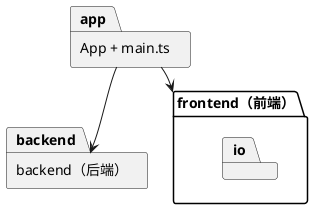

# REFACT：去掉 common，由 App 负责前后端之间的转换

- 提案时间：2026-10-16
- 完成时间：2026-10-16
- 类型：REFACT
- 关联 prd：doc/prd/phase1/20261016_CLI_REPL.md

<!-- 提案阶段：动因、决策记录、数据模型、架构 / 流程设计，讨论确认后方可进入开发 -->

## 动因

CLI_REPL 落地后，`common` 中只有 `CommandResult` 与 `EditorError` 两个类，名义上是前后端共享的中立模块，实际都属于后端：

- `CommandResult` 由后端（Command、Client、Invoker）创建与返回，前端只有 ResultPrinter 读取它。前端经由 `common` 依赖了后端的类型，"前后端互不依赖、只经由 App 通信"的规则只是被目录名掩盖，并未成立；
- `EditorError` 混合了两种来源：后端的业务错误（未知命令、参数格式等）与前端的分词错误（引号未闭合）。前端借用它只是为了让 App 能统一捕获；
- `common` 这个名字不表达职责，后续容易成为杂物堆。

## 决策记录

| 议题 | 选项 | 决定 | 理由 |
| --- | --- | --- | --- |
| common 的去留 | A：去掉 common，`CommandResult` / `EditorError` 归后端，前端只认字符串，由 App 负责转换；B：保留，改名为 `protocol` 表明是边界数据 | A | B 只改名，前端依赖后端类型的问题仍在；A 下前后端真正互不依赖，App 的"负责通信"落到实处 |
| 两个类在后端的位置 | A：`backend/` 根目录，与 `Client` 并列；B：新建 `backend/api/` | A | 它们是 Client 对外签名的一部分，与入口放在一起；目前只有两个类，不值得单独分包 |
| 前端的分词错误 | A：前端自有异常 `ParseError`，App 同时捕获 `ParseError` 与 `EditorError`；B：Tokenizer 不抛异常而返回错误值 | A | 与后端的报错方式一致；两类错误输出格式相同，在 App 一处合并 |
| ResultPrinter 的入参 | A：`printResult(warnings, lines)`，接收两组字符串；B：逐条 `printWarning` / `printLine`，由 App 控制顺序 | A | "先警告后结果行"与 `warning:` 前缀的规则仍只在 ResultPrinter 一处 |

## 数据模型

| 类 | 变更 | 说明 |
| --- | --- | --- |
| `CommandResult` | 移动：`common/` → `backend/` | 职责不变 |
| `EditorError` | 移动：`common/` → `backend/` | 只承载后端错误 |
| `ParseError` | 新增：`frontend/` | 前端输入无法解析时抛出（目前只有引号未闭合） |
| `Tokenizer` | 修改 | 引号未闭合时改抛 `ParseError` |
| `ResultPrinter` | 修改 | `printResult(result)` 改为 `printResult(warnings, lines)`，不再依赖 `CommandResult` |
| `App` | 修改 | 把 `CommandResult` 拆成警告与结果行交给 ResultPrinter；捕获 `ParseError` 与 `EditorError`，统一输出 `error: <消息>` |

## 架构 / 流程设计

### 模块与依赖方向

顶层规则（替换 CLI_REPL 提案中的对应条目）：

- frontend 与 backend 互不依赖，也没有共享模块；两者之间的数据转换只在 App 中进行。
- frontend 对外只交出参数数组与 `ParseError`，只接收字符串；backend 对外只有 `Client`、`CommandResult`、`EditorError`。
- backend 内部的依赖规则不变；`CommandResult`、`EditorError` 位于 backend 根目录，backend 内各模块均可依赖。

### 主循环（App.run 第 3、4 步的变化）

3. 调用 `client.execute(tokens)`，把结果拆成 `warnings()` 与 `lines()` 交给 `ResultPrinter.printResult` 打印。
4. 捕获 `ParseError`（分词时抛出）或 `EditorError`（执行时抛出），由 `ResultPrinter.printError` 打印 `error: <消息>`；其他异常视为程序缺陷，继续抛出。

### 对外行为

无变化：输出格式、报错文案、报错优先级均不变，现有端到端测试应原样通过。

<!-- 开发阶段：补齐以下内容；上方已确认的决策不得改动 -->

## 测试与验证

`npm test`：8 个测试文件、64 个用例全部通过；`npm run typecheck` 无错误。

| 用例 | 验证方式 | 结果 |
| --- | --- | --- |
| 对外行为不变：CLI_REPL 的全部 cases（输出格式、报错文案、报错优先级、脚本回放） | 原有端到端测试（App、main.test）原样通过 | 通过 |
| 引号未闭合时 Tokenizer 抛出 `ParseError` | 单元测试（Tokenizer） | 通过 |
| `ParseError` 经 App 输出为 `error: unclosed quote`，之后继续读取 | 端到端（App） | 通过 |
| ResultPrinter 接收两组字符串，先警告后结果行 | 单元测试（ResultPrinter） | 通过 |
| frontend 与 backend 互不引用，`src/common/` 已删除 | 检索 `src/frontend` 中对 backend、`src/backend` 中对 frontend 的 import，均无结果 | 通过 |

## 遗留问题

- 前后端互不依赖目前靠代码审查与检索保证，没有自动化检查；若后续模块增多，可补一条检查 import 方向的测试。
