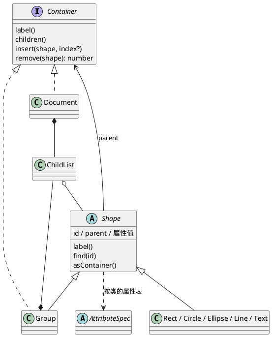
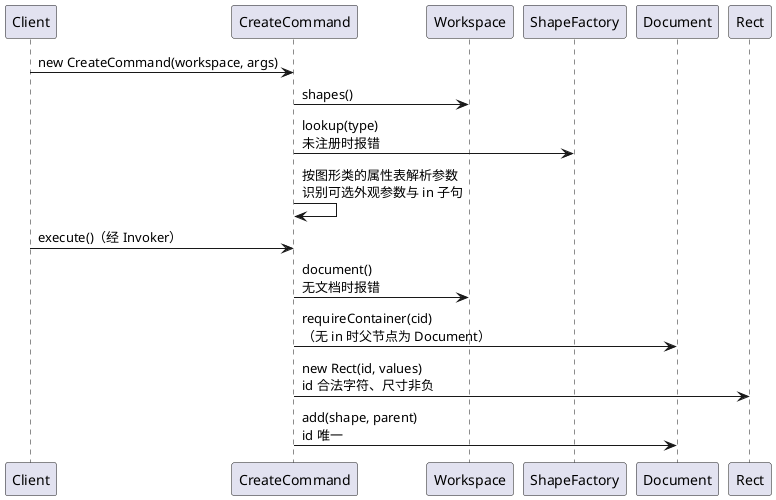

# FEAT：图形模型、创建与删除

- 提案时间：2026-10-20
- 完成时间：YYYY-MM-DD（开发完成后填写）
- 类型：FEAT
- 关联 prd：doc/prd/phase1/20261016_SHAPE_CREATE_DELETE.md

<!-- 提案阶段：动因、决策记录、数据模型、架构 / 流程设计，讨论确认后方可进入开发 -->

## 动因

本次实现 SHAPE_CREATE_DELETE 需求：建立图形树（6 种内置图形，容器与叶子统一操作），把 `create`、`delete` 由占位替换为真实实现，并让两者可撤销。

这是首个引入图形树与可撤销命令的需求，其余需求（显示、平移缩放与设置、层级调整、文件读写、撤销重做）都建立在本次确定的结构上，需要确定：

- 画布根、容器、叶子如何组成 Composite；
- 图形属性如何建模，使 create / set / show / save / read / move / scale 不必各自按属性名分支；
- 按类型名创建图形（课程允许的第二处按名分派）放在哪里、由谁持有；
- 可撤销命令的接口。

前置：DOCUMENT_CANVAS 已完成（Workspace、Document、"构造时解析参数、执行时取文档"的约定）。

## 决策记录

| 议题 | 选项 | 决定 | 理由 |
| --- | --- | --- | --- |
| 画布根的建模 | A：Document 即画布根，实现 `Container` 接口，顶层图形的父节点就是 Document；B：独立的根容器类，由 Document 持有 | A | `<svg>` 元素本身就同时承载画布尺寸与子图形；顶层图形与容器内图形的父节点统一为 `Container`，delete 的还原、后续 ungroup / addto 不必区分根级；少一个类 |
| id 查找与唯一性 | A：沿图形树递归查找，`find(id)` 在 Shape 上多态（叶子比对自身，Group 继续查子节点），不维护索引；B：Document 维护 id → Shape 索引 | A | 树是唯一的事实来源，delete 子树、undo、group、read 都不需要同步索引；文档规模小，遍历开销可忽略 |
| 图形属性的建模 | A：属性种类对象化：各图形类以静态成员声明属性表（属性名 → 属性种类），属性种类负责解析、校验、格式化（后续还负责平移 / 缩放）；图形实例按表持有属性值，各命令对属性表通用处理；B：类型化字段：每种图形用独立字段（如 Rect 的 x / y / width / height），set / show / 序列化由各类覆盖方法、按属性名读写；C：A 的变体，以字段装饰器声明属性种类，值存于类型化字段，框架经装饰器元数据读写 | A | B 下 set 要在每个类内按属性名分支，5 种叶子 × 多个操作重复同类代码；A 中"尺寸非负"等规则只写在属性种类一处，新增图形类型（含插件类型）只需声明属性表。C 换来字段级类型安全，但需改 vitest / tsconfig 配置并补 `Symbol.metadata` polyfill，且命令经属性表统一访问、很少直接读字段，收益有限。代价：叶子类以声明为主，行为集中在 Shape、Group 与属性种类 |
| 图形工厂 | A：`ShapeFactory` 持有"类型名 → 图形类"注册表；图形类以静态成员声明类型名与 create 参数（与 ConcreteCommand"静态成员即定义"一致）；内置 6 类在工厂构造时注册，后续 ShapeProvider 插件向同一工厂注册；B：工厂内按类型名 switch | A | 新增类型不改工厂代码，插件阶段只需开放注册入口。按名分派标注为待重构 |
| 工厂的持有者 | A：Workspace 持有，CreateCommand 经 Workspace 取得，后续 read 同样经 Workspace 取得；B：静态全局注册表；C：把 Client 的统一构造签名扩展为接收者集合 | A | 不改统一构造签名；每个 Workspace 一份，测试之间互不影响。代价：Workspace 的职责从"当前文档槽位"扩展为"编辑会话的接收者上下文" |
| create 的校验阶段 | A：构造时（参数格式）：类型已注册 → 参数个数（含 `in` 子句结构）→ 数字；执行时（业务校验）：无文档最先，其后为 id 合法字符、尺寸非负、id 唯一、`in` 目标存在且为容器；id 合法字符与尺寸非负是 Shape 的不变量，构造图形时校验；B：id 合法字符、尺寸非负也在构造命令时校验 | A | 沿用 DOCUMENT_CANVAS 的做法：领域对象自守约束，参数格式先于无文档；id 规则只在 Shape 一处，后续 group 新建容器、read 读入时复用 |
| 可撤销命令的接口 | A：新增抽象类 `EditCommand extends Command`，声明 `undo(): CommandResult`，create / delete 继承它；B：在 Command 基类上声明可选的 `undo` | A | 是否可撤销由类型表达，文档类、显示类命令不必写无意义的实现；落实 CLI_REPL"`undo()` 随首个可撤销命令引入"的决定 |
| redo 的实现方式 | A：redo 再次调用 `execute()`：命令在 `execute` 时按 id 解析目标，`undo` 只使用本次 `execute` 记录的引用，保证 undo 后可再次执行；B：单独的 `redo()`，复用首次执行时的对象 | A | PRD 要求 redo 回显与原命令执行时相同，复用 `execute` 即可满足；每个命令不必再写一遍 redo |

## 数据模型

### 图形树（Composite）

| 位置 | 类 / 接口 | 变更 | 职责 |
| --- | --- | --- | --- |
| backend/receiver/document | `Document` | 修改 | 画布根：在原有画布尺寸之外实现 `Container`，`label()` 为 `svg`；`find(id)`、`requireShape(id)`（不存在时报 `no such shape`）、`requireContainer(id)`（不存在报 `no such container`，不是容器报 `not a container`）、`add(shape, parent)`（id 已存在时报错，失败时状态不变） |
| backend/receiver/document | `Container`（接口） | 新增 | 能容纳子图形的节点（Document、Group）：`label()`、`children()`、`insert(shape, index?)`（省略 index 时追加到末尾）、`remove(shape): number`（返回原位置） |
| backend/receiver/document | `ChildList` | 新增 | 子节点序列，由 Document 与 Group 组合复用：维护顺序，插入 / 摘除时同步子图形的父节点 |
| backend/receiver/document/shape | `Shape` | 新增 | Component（抽象）：id（构造时校验合法字符）、父节点、属性值；统一声明外观属性 fill / stroke / stroke-width（对所有类型可选，未设置时不存在），各类不重复声明；`label()` 为 `<type>#<id>`；`find(id)`；`asContainer(): Container \| null`（叶子返回 null，用于"是不是容器"的判定，避免 instanceof） |
| backend/receiver/document/shape | `Group` | 新增 | Composite：`g`，实现 `Container`，`find` / 删除作用于整棵子树 |
| backend/receiver/document/shape | `Rect` / `Circle` / `Ellipse` / `Line` / `Text` | 新增 | Leaf：静态声明类型名 `type`、create 必填参数表 `params`（顺序即参数顺序，text 含内容 `text`）与 create 的可选外观参数 `paint`（rect / circle / ellipse 为 fill，line 为 stroke，text 与 g 无）；各类完整声明自己的 `params`，不在类之间共享（如 circle 与 ellipse 都声明 cx / cy） |
| backend/receiver/document/shape | `ShapeFactory` | 新增 | 类型名 → 图形类的注册表；`lookup(type)` 未注册时报 `unknown shape type: <type> (is the plugin loaded?)`。待重构：按名分派是课程允许的两处之一（图形工厂） |
| backend/receiver/workspace | `Workspace` | 修改 | 新增持有 `ShapeFactory`：`shapes(): ShapeFactory` |

### 属性种类

按"值在各通用操作（解析、不变量、输出、平移、缩放）下的行为"划分，至少一项行为不同才拆成不同种类：第一层按值的类型（解析与输出），第二层按不变量与几何变换中的角色。本次实现 `parse` / `check` / `format`，`translate` / `scale` 随 TRANSFORM_SET 补入。

```text
AttributeSpec（抽象）           name；parse（参数格式）/ check（不变量）/ format（输出）
├── NumericSpec（抽象）         parse 为数字，format 按数值格式
│   ├── CoordinateSpec(axis)    x y cx cy x1 y1 x2 y2：任意值；axis 供 move 使用
│   ├── LengthSpec              width height r rx ry：不得为负
│   └── StrokeWidthSpec         stroke-width：不得为负；缩放行为随 TRANSFORM_SET 确定，若决定缩放则并回 LengthSpec
└── StringSpec                  fill stroke text：原样保存，不校验
```

text 的内容在 save 时写成子文本而非元素属性，这是元素结构的差异，由 Text 负责，不另设属性种类。

### 命令

| 位置 | 类 | 变更 | 职责 |
| --- | --- | --- | --- |
| backend/command | `EditCommand` | 新增 | 可撤销命令的抽象基类：`undo(): CommandResult` |
| backend/command/impl | `CreateCommand` | 占位 → 实现 | 构造时：经 Workspace 查工厂得到图形类，按其属性表解析参数，识别可选外观参数与 `in` 子句；执行时：取 Document → 解析父容器 → 构造图形 → 加入文档，回显 `<type>#<id> created [in g#<cid>]`；undo 摘除本次创建的图形 |
| backend/command/impl | `DeleteCommand` | 占位 → 实现 | 执行时：按 id 找到图形，记录父节点与原位置后摘除（子孙随之脱离文档），回显 `<type>#<id> deleted`；undo 把同一对象插回原位置，回显 `<type>#<id> restored into <父节点 label>` |

示例写法：

```ts
// 叶子：以声明为主
export default class Rect extends Shape {
  static override readonly type = 'rect';
  static override readonly params = [          // create 必填参数，顺序即参数顺序
    new CoordinateSpec('x', 'x'), new CoordinateSpec('y', 'y'),
    new LengthSpec('width'), new LengthSpec('height'),
  ];
  static override readonly paint = 'fill';     // create 的可选外观参数
}

// 删除：undo 只使用本次 execute 记录的引用
export default class DeleteCommand extends EditCommand {
  private target: Shape | null = null;
  private parent: Container | null = null;
  private index = 0;

  execute(): CommandResult {
    this.target = this.workspace.document().requireShape(this.id);
    this.parent = this.target.parent();
    this.index = this.parent.remove(this.target);
    return new CommandResult().line(`${this.target.label()} deleted`);
  }

  undo(): CommandResult {
    this.parent.insert(this.target, this.index);
    return new CommandResult().line(`${this.target.label()} restored into ${this.parent.label()}`);
  }
}
```

## 架构 / 流程设计

模块划分与依赖规则沿用 CLI_REPL，不做变更。本次新增 / 修改的文件：

```text
src/backend/
├── command/
│   ├── EditCommand.ts
│   └── impl/
│       ├── CreateCommand.ts             占位 → 实现
│       └── DeleteCommand.ts             占位 → 实现
└── receiver/
    ├── workspace/
    │   └── Workspace.ts                 修改：持有 ShapeFactory
    └── document/
        ├── Document.ts                  修改：画布根，实现 Container
        ├── Container.ts
        ├── ChildList.ts
        ├── shape/
        │   ├── Shape.ts
        │   ├── Group.ts
        │   ├── Rect.ts
        │   ├── Circle.ts
        │   ├── Ellipse.ts
        │   ├── Line.ts
        │   ├── Text.ts
        │   └── ShapeFactory.ts
        └── attribute/
            ├── AttributeSpec.ts
            ├── NumericSpec.ts
            ├── CoordinateSpec.ts
            ├── LengthSpec.ts
            ├── StrokeWidthSpec.ts
            └── StringSpec.ts
test/                                    目录结构与 src 对应，每个新增类一份单元测试；main.test 补端到端用例
```

### 图形树结构



### create 流程



参数解析：必填参数按 `params` 的顺序逐个解析（text 的内容位上出现 `in` 视为内容）；必填参数之后，第一个词若是 `in` 则一律视为关键字，其后须恰好跟一个容器 id；否则视为可选外观参数，之后可再跟 `in <cid>`；多余或缺少的词报参数个数不符，并附该类型的语法。

### 变化点

| 变化点 | 预留 |
| --- | --- |
| 插件图形类型（ShapeProvider，如 box） | 向 Workspace 持有的 `ShapeFactory` 注册新图形类，内核不改 |
| move / scale | 属性种类上补充 `translate` / `scale`（CoordinateSpec 按 axis 平移），Group 递归到子孙 |
| set / show / tree | 复用属性表与属性种类的解析、校验、格式化 |
| save / read | 复用属性种类的格式化与解析；read 经同一工厂按元素名构造图形 |

### 本次不做

- Invoker 的 undo / redo 栈与 CLI 中的 `undo` / `redo`：随撤销需求落地，本次 `undo()` 只在单元测试中直接调用；
- 属性修改、平移、缩放、显示、文件读写：随各自需求落地；
- `box`：本阶段按未注册类型报错。

<!-- 开发阶段：补齐以下内容；上方已确认的决策不得改动 -->

## 测试与验证

| 用例 | 验证方式 | 结果 |
| --- | --- | --- |
| | | |

## 遗留问题

- 
