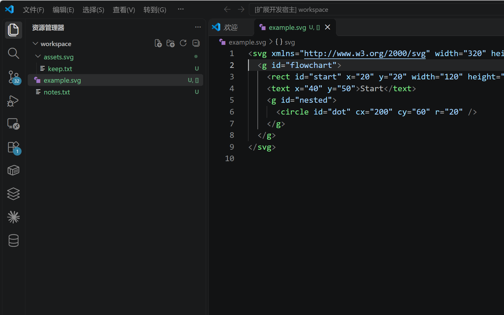
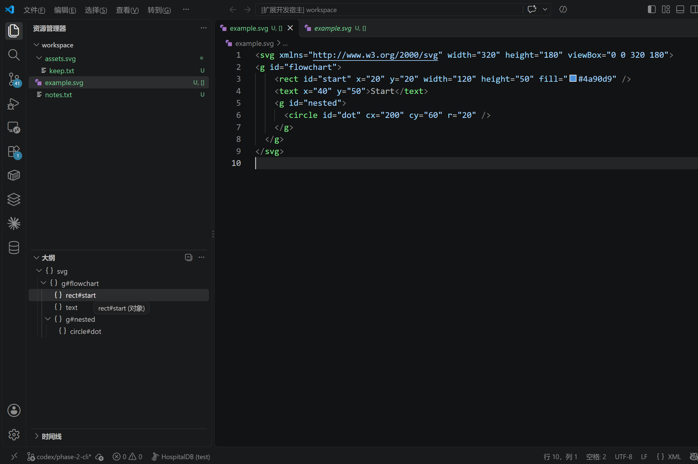

# VS Code 扩展验收

本文件记录 A.1/A.2/A.3 的验收环境、结果、证据和复现命令。架构说明见 [`architecture.md`](architecture.md)，入口见 [`../README.md`](../README.md)。

## 1. 环境

- 日期：2026-11-27
- VS Code：1.148.0
- Node.js：22.23.2
- 工作区：`vscode-extension/samples/workspace`
- 运行方式：VS Code 扩展开发宿主（`--extensionDevelopmentPath` / F5）

## 2. 结论

| 检查点 | 结果 | 说明 |
| --- | --- | --- |
| A.1 SVG 文件标记 | 通过 | `.svg` 显示 `[]`；普通文件和目录不显示；扩展不写文件 |
| A.2 原生 SVG 大纲 | 通过 | 展示 `svg → g#flowchart → rect#start / text → g#nested → circle#dot`；`selectionRange` 断言第 3 行；编辑更新和不完整 XML 有单元测试 |
| A.3 说明与演示材料 | 通过 | 架构、职责、Decorator/Adapter 对比、Phase 1 复用评估和证据索引已归档 |

## 3. 结果

### A.1 SVG 文件标记

- `example.svg` 在 Explorer 中显示 `[]`；`notes.txt` 和目录 `assets.svg` 没有标记。
- 扩展只调用 `workspace.fs.stat` 读取类型，不写文件；样例文件内容保持原值。
- 证据：[Explorer 截图](evidence/screenshots/explorer-badge.png)
- 自动化测试：`SvgFileDecorationProvider.test.ts` 覆盖 SVG、普通文件、目录、大小写和 stat 失败。



### A.2 原生 SVG 大纲

- 基线观察：`.svg` 默认以图片预览打开时，原生 Outline 显示“活动编辑器无法提供大纲信息”；用 `Reopen Editor With...` 切到 Text Editor 后显示符号树。
- Outline 展示根 `svg`、容器 `g#flowchart`、叶子 `rect#start`、无 id 的 `text`，以及嵌套的 `g#nested / circle#dot`。
- 选中 `rect#start` 时，`DocumentSymbol.selectionRange` 指向起始标签名；`SvgDocumentSymbolProvider.test.ts` 断言其位于第 3 行（0-based line 2），点击定位由 VS Code 使用该范围。
- `provideDocumentSymbols` 每次读取 `document.getText()`，未保存编辑也会重新解析；测试覆盖 id/层级变化。
- 不完整 XML 由 parser 返回空数组，provider 不抛异常；测试覆盖未闭合标签、错配标签、未闭合注释和未闭合引号。
- 证据：[Outline 截图](evidence/screenshots/outline.png)
- 自动化测试：`SvgSourceParser.test.ts`、`SvgDocumentSymbolProvider.test.ts`。



### A.3 说明与演示材料

- 职责和调用流程见 [`architecture.md`](architecture.md#3-运行时流程)。
- 文件装饰与经典 Decorator/Adapter 的差异见 [`architecture.md`](architecture.md#5-设计模式)。
- Phase 1 解析、模型和遍历的复用评估见 [`architecture.md`](architecture.md#6-与-phase-1-的复用评估)。
- 复现步骤见 [`../README.md`](../README.md#快速开始) 和本文件第 5 节。

## 4. 测试与构建

执行目录：`vscode-extension`。

| 命令 | 结果 |
| --- | --- |
| `npm run typecheck` | 通过 |
| `npm test` | 5 个测试文件、16 项测试通过 |
| `npm run build` | 通过，生成 `out/extension.js` |
| `npm run metrics:worktree` | 生成 [VS Code 指标](evidence/vscode-metrics.md) |

CLI 回归（执行目录：`cli`，不依赖扩展）：

| 命令 | 结果 |
| --- | --- |
| `npm test` | 62 个测试文件、564 项测试通过 |
| `npm run typecheck` | 通过 |
| `npm run verify:transcripts` | `phase1`、`box`、`commands` 全部通过 |

## 5. 复现命令

```bash
cd vscode-extension
npm install
npm run typecheck
npm test
npm run build
code --extensionDevelopmentPath=. samples/workspace
```

在扩展开发宿主中：

1. 确认 `example.svg` 显示 `[]`，`notes.txt` 和 `assets.svg` 目录没有标记。
2. 用 `Reopen Editor With...` 选择 Text Editor 打开 `example.svg`。
3. 展开 Outline，确认层级；选中 `rect#start`，确认 `selectionRange` 指向起始标签。
4. 修改 id 或结构，确认 Outline 更新；删除结束标签，确认 Outline 清空且扩展不崩溃，补齐后恢复。

## 6. 证据索引

| 证据 | 位置 |
| --- | --- |
| Explorer 标记截图 | [screenshots/explorer-badge.png](evidence/screenshots/explorer-badge.png) |
| Outline 截图 | [screenshots/outline.png](evidence/screenshots/outline.png) |
| VS Code 源码指标 | [vscode-metrics.md](evidence/vscode-metrics.md) |
| 扩展测试 | [test/](../test/) |
| 示例工作区 | [samples/workspace/](../samples/workspace/) |

指标当前由 `npm run metrics:worktree` 生成，目标列显示 `WORKTREE`；最终候选提交确定后执行 `npm run metrics`，按 `HEAD` 重新生成。

## 7. 已知限制

- `SvgSourceParser` 只解析元素结构、id 和源码 offset，不做完整 XML/SVG 规范校验，也不提供图形预览。
- Outline 对不完整 XML 采用“清空后恢复”策略，不保留旧位置；这是 A.2 允许的暂态。
- 扩展不读取磁盘文件内容生成 Outline，始终使用当前编辑器文本。
